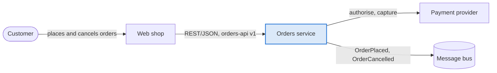
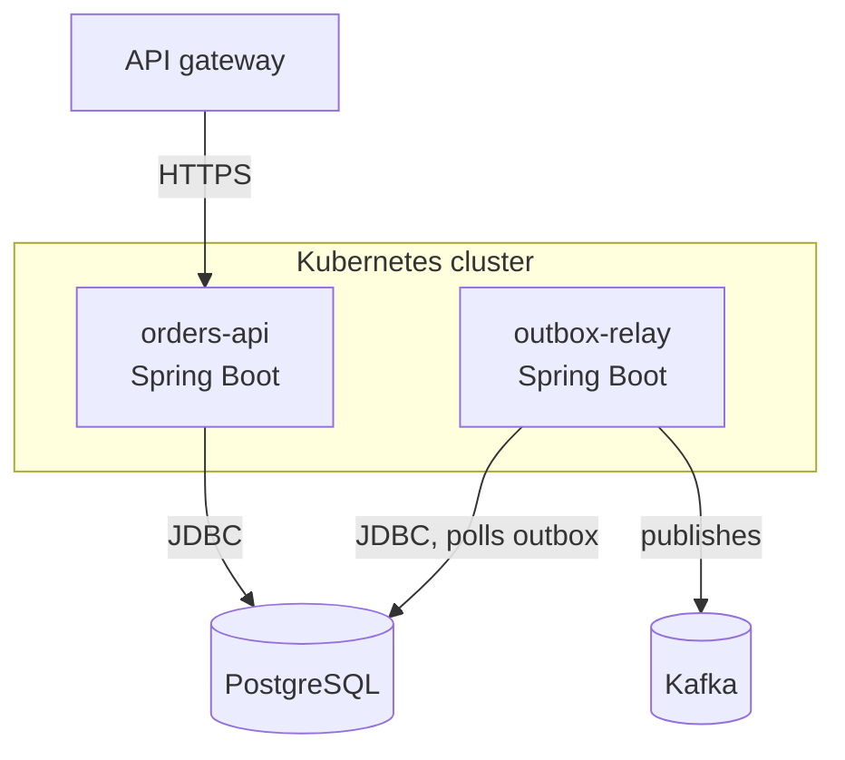
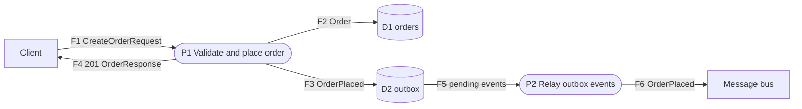
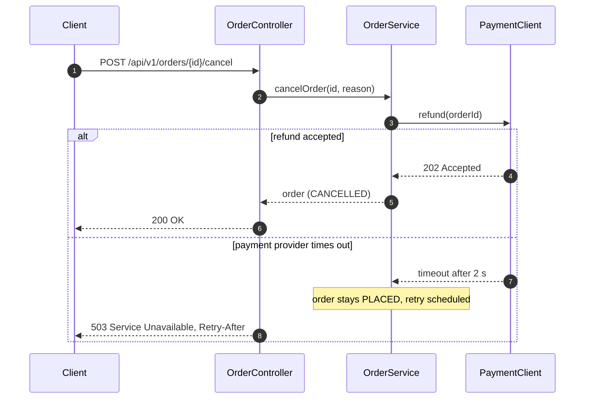
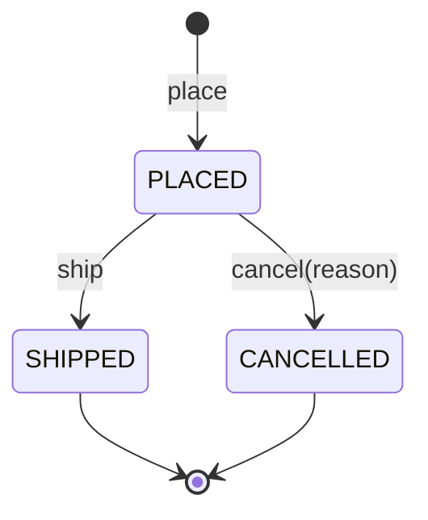
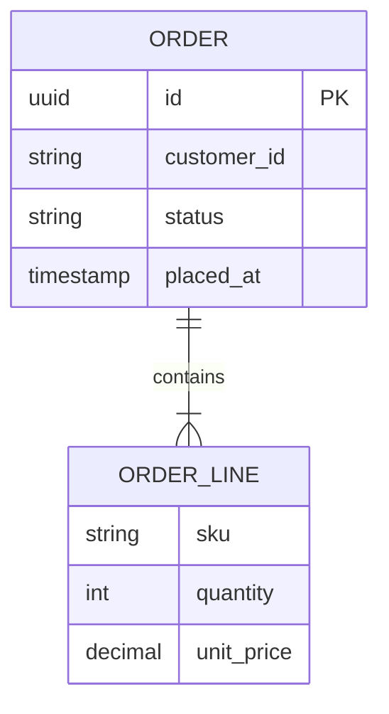
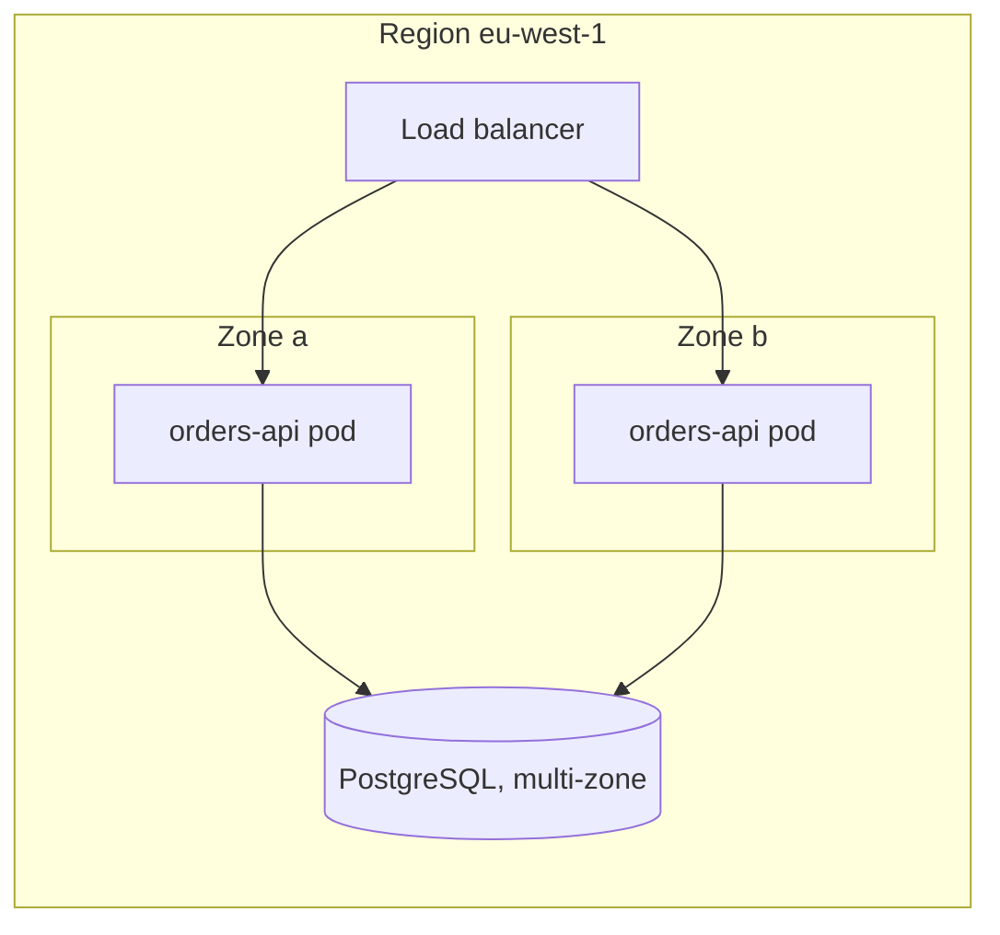
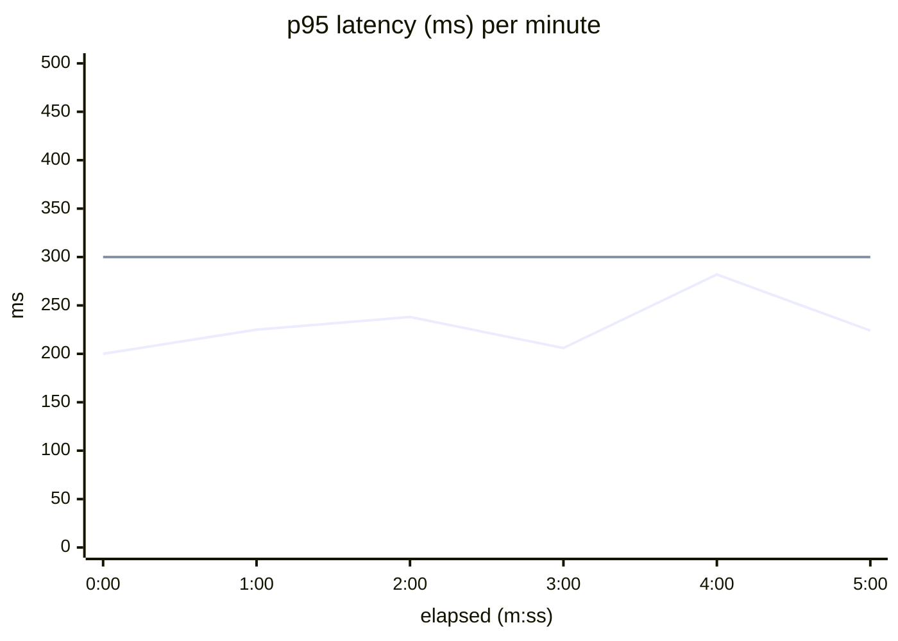
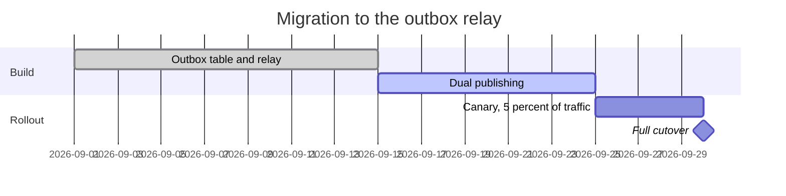

# Diagram cookbook (Mermaid)

Diagrams are text: they diff in PRs, render on GitHub, and Claude can read and update them. Each pattern below answers
one question. Copy the closest one, replace the names with the ones from the code, and keep it to 12 nodes.

| Question | Pattern | Mermaid type |
|---|---|---|
| Who uses the system and what does it depend on? | System context | `flowchart` (C4 level 1 style) |
| Which deployable units exist and how do they talk? | Containers | `flowchart` with `subgraph` |
| What data moves between which parts? | Data flow | `flowchart` in DFD notation plus a flow table |
| What happens on a request, including failures? | Key flow | `sequenceDiagram` |
| Which states can an entity be in? | Lifecycle | `stateDiagram-v2` |
| How is the data shaped? | Data model | `erDiagram` |
| What runs where? | Deployment | `flowchart` with nested `subgraph` |
| How did a metric behave over time? | Time series | `xychart-beta` (Git) or `scripts/docs/chart.py` (Confluence) |
| When does the rollout happen? | Timeline | `gantt` |

## Conventions

- Direction: `LR` for flows and context, `TB` for layers and deployment.
- Names from the code: class, endpoint, topic and table names, so readers can grep them.
- Mark the system you are describing with a `classDef` (filled box); external systems stay plain.
- Quote labels that contain parentheses, slashes or colons: `A -->|"POST /orders (JSON)"| B`, `A["Order (aggregate)"]`.
- Two-line labels use ` `.
- A caption under every diagram, in italics, stating the takeaway: *Figure 3: F2 and F3 commit in one transaction.*
- Gotchas: a node called `end` breaks flowcharts (use `End` or quotes); `subgraph` ids must differ from node ids;
  `%%` starts a comment; `xychart-beta` accepts only numbers and has no legend (use one chart per series).
- Validate before publishing: `python3 scripts/docs/confluence_publish.py <doc.md> --dry-run --strict`.

## System context (C4 level 1)

Pair it with a table of external systems: direction, protocol and format, data, owner, SLA.

## Containers (C4 level 2)

## Data flow (DFD notation)

External entities are rectangles, processes are stadium shapes numbered `P1..Pn`, data stores are cylinders numbered
`D1..Dn`, and every arrow carries the data that moves, numbered `F1..Fn`. The diagram shows the shape; the flow table
carries volume, format, classification and consistency.

| Flow | From → To | Data (schema or contract) | Protocol and format | Volume and frequency | Classification | Consistency and retry |
|---|---|---|---|---|---|---|
| F1 | Client → P1 | CreateOrderRequest (orders-api v1) | HTTPS, JSON | 50 req/s peak, 2 KB | internal, customer id | idempotent via Idempotency-Key |
| F2 | P1 → D1 | Order | SQL | 1 row per order | PII: customer id | one transaction with F3 |
| F6 | P2 → bus | OrderPlaced v1 | Kafka, Avro | 1 event per order | internal | at-least-once; consumers dedupe |

For a level-0 (context) DFD, collapse all processes into one box and keep the external entities and flows.

## Key flow with failure path

Use `opt` for optional steps, `loop` for retries, `par` for parallel calls. One diagram per scenario; split rather than cram.

## Lifecycle

Derive the transitions from the aggregate (for example `Order`) and keep them in sync with its unit tests.

## Data model

## Deployment

## Time series

`scripts/docs/perf_report.py` emits this chart from the results; the second line is the SLO. It renders on GitHub.
For Confluence, render the same CSV with `scripts/docs/chart.py` (SVG or PNG), which adds a legend and a labelled
threshold line.

Use `bar [...]` instead of `line [...]` for per-scenario comparisons. One measure per chart; never two y-axes.

## Timeline

## Rendering outside GitHub

Confluence does not render Mermaid natively. Options, in order of preference:

1. `scripts/docs/confluence_publish.py` renders every Mermaid block to PNG with mermaid-cli and attaches it.
2. A Mermaid macro from the Atlassian Marketplace, if your Confluence has one.
3. draw.io in Confluence: Arrange → Insert → Advanced → Mermaid turns the source into an editable diagram.

Keep the Mermaid source in Git either way; the image is a build artifact.
