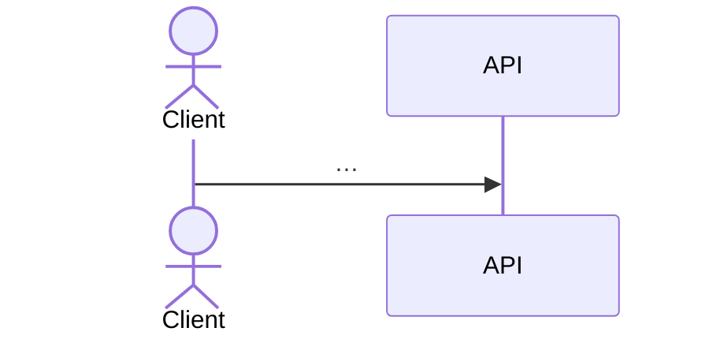

# <ID>: <Title>

| Field | Value |
|---|---|
| Status | Draft / Ready / Done |
| Owner (PM) | @handle |
| Tech lead | @handle |
| Contract impact | none / additive / breaking |
| Related | ADR-NNNN, issue #NNN |

## Problem
Who has the problem, what it is, and why it matters now. Two or three sentences.

## Acceptance criteria
Each criterion maps to at least one automated test (see the "Traceability" section).

- **AC1**: Given …, when …, then …
- **AC2**: Given …, when …, then …

## Contract impact
Endpoints and fields added or changed. Link to `contracts/openapi/…`.

## Flow

## Out of scope
- …

## Open questions
- [ ] …

## Traceability (filled in by the implementer)
| AC | Unit test | Integration test |
|----|-----------|------------------|
