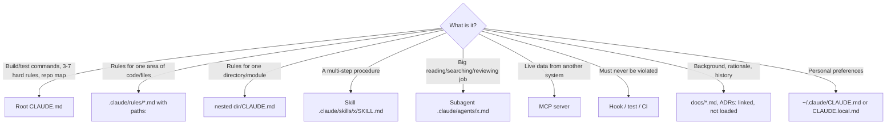

# 01: Context engineering: signal vs noise

Claude's context window is its working memory. Everything in it competes for attention: system prompt,
`CLAUDE.md`, tool definitions, files it read, command output, and the conversation so far. On a large
project the failure mode is rarely "Claude didn't know". It's usually one of these:

1. **Too much:** 800 lines of `CLAUDE.md`, 12 MCP servers and a 5,000-line build log drown the one rule that mattered.
2. **Stale:** docs describe last year's architecture, and Claude follows them confidently.
3. **Unenforced:** "please always write tests" is a wish. A failing gate is a fact.

## The four questions for every piece of context

| Question | If "no" |
|---|---|
| Is it needed in **most** sessions? | Don't put it in root `CLAUDE.md`. Use a path rule, nested `CLAUDE.md`, skill or doc link |
| Is it **true right now**, and will it stay true? | Generate it from code, test it, or delete it |
| Could a tool **enforce** it instead? | Write a hook, test, ArchUnit rule or CI check. Keep one line of guidance at most |
| Is it **specific** to this repo? | Delete it. Claude already knows Java, Spring, and what clean code is |

## Where each kind of information goes

## Noise-reduction techniques used in this repo

| Technique | Where | Why it helps |
|---|---|---|
| Root `CLAUDE.md` under ~50 lines | `CLAUDE.md` | Loaded every session. Every line costs attention forever |
| **Link, don't import** | `CLAUDE.md` points to `docs/architecture/overview.md` | Loaded only when relevant. `@imports` would inline it every time |
| Path-scoped rules | `.claude/rules/testing.md` (`paths: src/test/**, src/integrationTest/**`) | Test rules only appear when touching tests |
| Nested memory | `contracts/CLAUDE.md` | Contract rules appear only when working in `contracts/` |
| Skills (progressive disclosure) | `.claude/skills/*` | Only name + description sit in context. The body loads when used |
| Reference files inside skills | `contract-change/compatibility-rules.md` | Loaded only when the skill needs to classify |
| Subagents | `code-reviewer`, `contract-guardian` | Big diffs and reads happen in *their* context. Only a verdict comes back |
| Quiet-on-success scripts | `scripts/verify.sh` | Green = one line. Red = only the relevant error lines, not 3,000 lines of Gradle output |
| Enforcement over prose | ArchUnit, JaCoCo, hooks | No need to repeat rules in markdown. The failure message teaches at the right moment |
| Few MCP servers, scoped per project | [06](06-mcp-and-tools.md) | Each server adds tool definitions and potential for wrong-tool use |

## Session hygiene (habits, not files)

- **One task per session.** `/clear` between unrelated tasks. Leftover context from task A misleads task B.
- **Plan mode for anything non-trivial** (Shift+Tab). Review the plan before any code is written. It's the cheapest point to correct course.
- **`/context`** shows what fills the window. Check it when quality drops.
- **`/compact <focus>`** when a long task is still going: "compact, keep the AC list and failing test names".
- **Point, don't paste.** "Read `docs/specs/ORD-002-cancel-order.md`" beats pasting the spec into chat.
- **Give Claude a way to check its work** (a test, a script, a URL). Verification loops beat longer instructions.

## Anti-patterns

| Anti-pattern | Better |
|---|---|
| Copying the whole style guide into `CLAUDE.md` | Formatter/linter + one line "run `./gradlew check`" |
| "IMPORTANT!!! NEVER …" repeated ten times | One rule, plus a hook that enforces it |
| Describing the architecture in prose that nobody updates | An ArchUnit test, plus a diagram checked in the PR template |
| `@docs/everything.md` imports in `CLAUDE.md` | Plain links. Claude opens them when needed |
| Letting Claude read full test logs | Scripts that filter to failures |
| One long session for a week of work | Short sessions, specs and ADRs as the durable memory |
