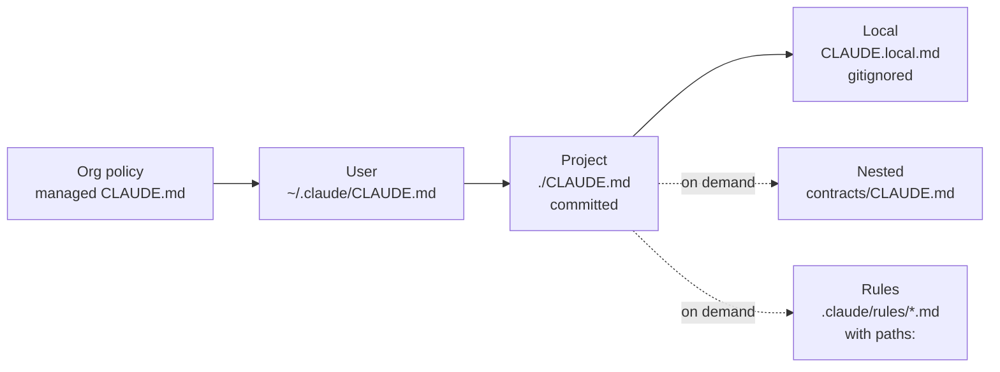

# 02: CLAUDE.md, nested memory and rules

## The memory hierarchy

Claude Code loads instructions from several places. More specific ones add to or override more general ones.



| File | Loaded | Shared? | Use for |
|---|---|---|---|
| `~/.claude/CLAUDE.md` | every session, every repo | no | personal style ("explain before editing") |
| `./CLAUDE.md` | every session in this repo | **yes (git)** | commands, non-negotiables, map |
| `CLAUDE.local.md` | every session in this repo | no (gitignored) | your sandbox URLs, local quirks |
| `dir/CLAUDE.md` | when Claude reads files under `dir/` | yes | module-specific rules |
| `.claude/rules/x.md` without `paths` | every session | yes | splitting a big CLAUDE.md into topics |
| `.claude/rules/x.md` with `paths:` | when working on matching files | yes | language/area rules |

Run `/memory` to see which files are loaded right now.

## What goes in the root CLAUDE.md

Look at [`/CLAUDE.md`](../CLAUDE.md). It has exactly five parts:

1. **One-line identity**: what this is, and where the docs live.
2. **Commands**: build, fast test loop, single test, the gate. Claude uses them constantly, and getting them
   wrong wastes whole turns.
3. **Architecture in 3 lines**, pointing at the test that enforces it and the doc that explains it.
4. **Non-negotiables**: at most 5–7. Each one is backed by a mechanism (hook/test/CI) and a skill that explains *how*.
5. **Map**: where specs, ADRs and rules are. Links, not content.

What is *not* in it: Java style (in the path rule), test conventions (in the path rule), contract procedure (skill),
architecture detail (doc and ArchUnit), anything Claude already knows.

### Writing rules that work

- **Be concrete and checkable:** "Inject `java.time.Clock`. Never call `Instant.now()`", not "handle time properly".
- **Say what to do instead**, not only what to avoid.
- **Give the reason when it isn't obvious.** Claude generalises better from "because the domain must stay
  unit-testable" than from a bare rule.
- **Emphasis sparingly.** If everything is IMPORTANT, nothing is.
- **Prune.** When Claude repeatedly does something right without the rule, delete the rule. When it repeatedly
  gets something wrong, first ask "can a tool enforce this?", and only then add a line.

## Path-scoped rules: `.claude/rules/`

```markdown
---
paths:
  - "src/test/**"
  - "src/integrationTest/**"
---
# Test rules
- `*Test.java`: unit tests. No Spring context …
```

This repo has three:

| Rule file | Applies to | Content |
|---|---|---|
| [`java.md`](../.claude/rules/java.md) | `src/main/**/*.java` | injection, records, Clock, Money, error mapping |
| [`testing.md`](../.claude/rules/testing.md) | `src/test/**`, `src/integrationTest/**` | unit vs IT, naming ↔ ACs, fakes, AssertJ, no weakening |
| [`docs.md`](../.claude/rules/docs.md) | `docs/**`, `**/*.md` | Mermaid, diagram upkeep, spec ownership |

In a multi-project Gradle (or multi-module Maven) build, add one rule file per module or technology
(`persistence.md` → `**/infrastructure/**`, `kafka.md` → `**/messaging/**`). A developer fixing a controller never pays for the Kafka rules.

## Nested CLAUDE.md

[`contracts/CLAUDE.md`](../contracts/CLAUDE.md) appears only when Claude touches files in `contracts/`. Use nested files for
**directories with a different "physics"**: generated code ("never edit, regenerate with …"), a legacy
module ("no refactors, bug fixes only"), a shared library ("public API, semver").

## @imports: use rarely

`@path/to/file.md` inside CLAUDE.md inlines that file **every session**. That's good for a 10-line shared snippet,
and bad for a 400-line architecture doc. Prefer a plain link. Claude opens it when the task needs it.

## Bootstrapping on an existing project

1. Run `/init` to get a draft `CLAUDE.md` generated from the codebase.
2. **Cut it by half.** Delete everything generic, and move area-specific parts into `.claude/rules/`.
3. Add the non-negotiables and point each at its enforcement.
4. Commit it. Review changes to it like code (see `.github/CODEOWNERS`).
