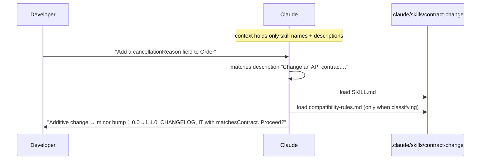

# 03: Skills: reusable workflows

A **skill** is a folder with a `SKILL.md` (frontmatter + instructions) and optional supporting files.
At session start Claude sees only each skill's `name` and `description`. It loads the body when the task matches,
or when you invoke it with `/skill-name`. That's **progressive disclosure**: you can have 20 detailed procedures
at a cost of 20 one-liners.



## Skills in this repo

| Skill | Trigger | What it standardises |
|---|---|---|
| [`tdd-feature`](../.claude/skills/tdd-feature/SKILL.md) | adding or changing behaviour | spec → AC list → test matrix → red → green → refactor → gate |
| [`contract-change`](../.claude/skills/contract-change/SKILL.md) | anything under `contracts/` | classify, version, changelog, ADR, code alignment |
| [`pr-ready`](../.claude/skills/pr-ready/SKILL.md) | "done?" / "open a PR" | AC → test mapping, gate, reviewer subagent, PR template |
| [`write-adr`](../.claude/skills/write-adr/SKILL.md) | decisions | ADR numbering, alternatives, status rules |
| [`write-spec`](../.claude/skills/write-spec/SKILL.md) | new feature idea (PMs) | Given/When/Then ACs, out-of-scope, open questions |
| [`update-diagrams`](../.claude/skills/update-diagrams/SKILL.md) | flow/boundary changes | Mermaid types, derive from code, size limits |

## Anatomy

```markdown
---
name: contract-change
description: Change an API contract in contracts/ … Use before editing any file under contracts/, or when a
  feature needs a new/changed endpoint or field.
---
# Contract change procedure
1. Confirm the change is wanted …
2. Classify (see [compatibility-rules.md](compatibility-rules.md)) …
```

- **The description is the trigger.** Say *what* it does and *when* to use it, using the words people actually type.
- **Numbered steps** with explicit "stop and ask" points.
- **Supporting files** for reference material that's only needed sometimes.
- **End with verification**: which command proves the job is done.
- Optional frontmatter: `allowed-tools` (restrict tools while the skill runs) and `disable-model-invocation: true`
  (manual `/name` only). Use the latter for risky workflows such as releases.

## When to write a skill

- You've typed the same multi-step instruction more than twice.
- A procedure has a **correct order** (contract before code, test before implementation).
- Several roles need the same process (PMs and devs both use `write-spec`).

**Don't** write skills for things one command does. Put the command in CLAUDE.md instead.

## Skills vs CLAUDE.md vs subagents

| | CLAUDE.md | Skill | Subagent |
|---|---|---|---|
| Loaded | always | on match | on delegation |
| Runs in | main context | main context | **own** context |
| Best for | facts and rules | procedures | big reading/reviewing jobs, parallel work |
