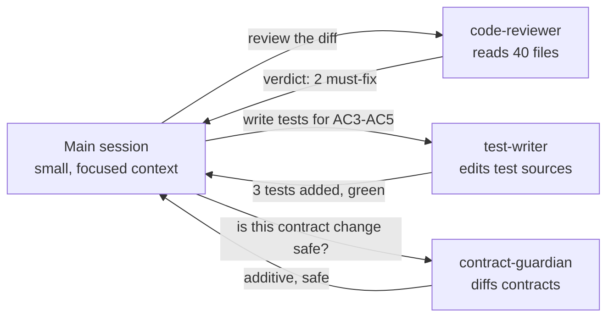

# 04: Subagents: isolated context

A **subagent** is a separately configured Claude with its **own context window**, its own tool list and a
focused system prompt (`.claude/agents/<name>.md`). The main session delegates a job and gets back only the result.

That's the main answer to "how do I stop context pollution on a big codebase": expensive exploration happens
somewhere else.

## Subagents in this repo

| Agent | Tools | Writes? | Use |
|---|---|---|---|
| [`code-reviewer`](../.claude/agents/code-reviewer.md) | Read, Grep, Glob, Bash | no | self-review before a PR (called by `pr-ready`) |
| [`test-writer`](../.claude/agents/test-writer.md) | + Edit, Write | tests only | fill test gaps, or parallelise tests per AC |
| [`contract-guardian`](../.claude/agents/contract-guardian.md) | Read, Grep, Glob, Bash | no | compatibility verdict on contract diffs |

Claude Code also has a built-in **Explore** agent for read-only codebase searches. Use it ("use an explore
agent to find every place that builds an OrderResponse") instead of letting the main session grep through 200 files.

## Design rules

1. **Least privilege:** reviewers get no Edit/Write. That alone prevents a reviewer from "fixing" things mid-review.
2. **Fixed output format:** a short, structured verdict (see `code-reviewer.md`). A free-form essay just moves the noise back into the main context.
3. **Clear "never" list:** `test-writer` never changes production code or contracts. A test that exposes a bug is *reported*.
4. **Description = when to use.** Add "use proactively" if you want Claude to delegate without being asked.
5. **Independent jobs in parallel:** "use three test-writer agents, one per acceptance criterion".

## When not to use a subagent

- Small tasks that need the main conversation's context. Handing it over costs more than doing it.
- Tightly interactive work where you want to see every step.

Manage agents with `/agents`.
