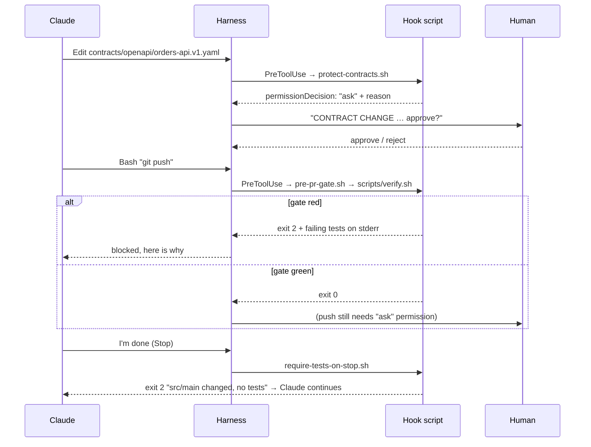

# 05: Hooks and permissions: guardrails

Markdown is guidance. It can be forgotten, misread or pushed out of context. **Hooks** are shell commands the
Claude Code harness runs at fixed points. They run every time, whatever the model "decides". **Permissions** decide
which tools and commands run freely, need confirmation, or are forbidden.

## The hooks in this repo

Configured in [`.claude/settings.json`](../.claude/settings.json), with scripts in [`.claude/hooks/`](../.claude/hooks/).



| Hook | Event / matcher | Guarantees |
|---|---|---|
| [`protect-contracts.sh`](../.claude/hooks/protect-contracts.sh) | `PreToolUse` · `Edit\|Write\|MultiEdit` | A human confirms every contract edit. The contract stays intact by default but **can** change (see [07](07-contracts.md)) |
| [`pre-pr-gate.sh`](../.claude/hooks/pre-pr-gate.sh) | `PreToolUse` · `Bash\|mcp__github__create_pull_request` | `git push`, `gh pr create` and MCP PR creation run only if `scripts/verify.sh` is green |
| [`require-tests-on-stop.sh`](../.claude/hooks/require-tests-on-stop.sh) | `Stop` | Claude can't declare "done" with production changes and no test changes |

### How hooks talk back

- **Exit 0**: continue. For `PreToolUse`, stdout JSON can return `permissionDecision` (`allow` / `ask` / `deny`) plus a reason.
- **Exit 2**: block. **stderr is fed to Claude**, so write it as an instruction: what failed and what to do next.
- **Other exit codes**: non-blocking error, shown to the user.
- Hook input arrives as JSON on stdin (`tool_name`, `tool_input`, `stop_hook_active`, …). Use `jq`.

### Hook design rules

1. **Fast and cheap on the hot path.** `protect-contracts.sh` is a `case` on a path. The expensive build runs only at
   push time.
2. **Quiet on success.** Anything printed may end up in context. `verify.sh` prints one line when green.
3. **Actionable on failure.** Filter logs down to the failing test and assertion, and say what to do instead.
4. **Loop-safe.** The Stop hook checks `stop_hook_active` so it blocks at most once per turn.
5. **One source of truth.** Hooks call `scripts/*`, and CI calls the same scripts. Local and CI can't disagree.
6. **Protect the guardrails.** `settings.json` puts `Edit(.claude/hooks/**)` and `Edit(.claude/settings.json)` under `ask`, and CODEOWNERS requires tech-lead review.

Other useful events: `PostToolUse` (run a formatter such as Spotless after an edit), `SessionStart` (warm the Gradle cache in
cloud sessions), `UserPromptSubmit` (inject the current sprint's spec IDs), `PreCompact`. Inspect them with `/hooks`.

## Permissions

```json
"permissions": {
  "allow": ["Bash(./gradlew:*)", "Bash(scripts/verify.sh:*)", "Bash(git diff:*)", …],
  "ask":   ["Bash(git push:*)", "Edit(build.gradle.kts)", "Edit(gradle/**)", "Edit(.github/**)", "Edit(.claude/hooks/**)"],
  "deny":  ["Read(./.env)", "Read(./secrets/**)", "Bash(git push --force:*)", "Bash(rm -rf:*)", "Bash(./gradlew publish:*)"]
}
```

- **allow** what's safe and frequent (the build and read-only git). Fewer prompts means fewer rubber-stamp approvals.
- **ask** for anything that changes shared state or guardrails (push, build config, the Gradle wrapper, CI, hooks).
- **deny** secrets and destructive commands outright.

Precedence (highest first): org-managed settings → CLI flags → `.claude/settings.local.json` (personal, gitignored)
→ `.claude/settings.json` (team, committed) → `~/.claude/settings.json` (user). Put team guardrails in the committed file.
Organisations can enforce them with managed settings.
