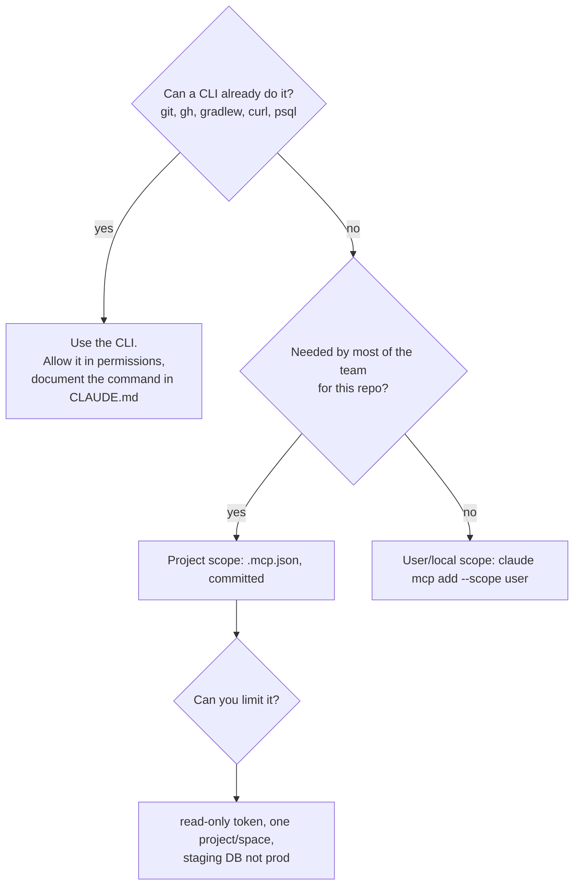

# 06: MCP servers and tools

**MCP (Model Context Protocol)** servers give Claude tools for external systems such as issue trackers, GitHub,
databases, docs and observability. They're powerful, and they're also the easiest way to add noise: every server
brings tool definitions, and every tool is one more wrong choice Claude can make.

## Decide in this order



## Recommended set for a Java team

| Need | Option | Notes |
|---|---|---|
| Issues/PRs | `gh` CLI **or** the GitHub MCP server | the CLI costs no context. MCP helps where there's no shell |
| Tickets and specs | Jira/Linear/Atlassian MCP | read ACs straight from the ticket into `docs/specs/` via `write-spec` |
| Library docs | a docs MCP (e.g. Context7) | up-to-date Spring/library APIs instead of stale training data |
| Database | Postgres MCP against a **read-only** dev/staging role | never production credentials |
| Browser/UI checks | Playwright MCP | only for repos with a UI |

## Project configuration

A template is in [`docs/templates/mcp.json`](templates/mcp.json). Copy it to `.mcp.json` at the repo root and keep only what you need:

```json
{
  "mcpServers": {
    "github": {
      "type": "http",
      "url": "https://api.githubcopilot.com/mcp/",
      "headers": { "Authorization": "Bearer ${GITHUB_PAT}" }
    }
  }
}
```

- **Secrets via `${ENV_VAR}` expansion**, never literal tokens in git.
- Team members approve project servers on first use. Check what's loaded with `/mcp`.
- This demo repo ships **no** active `.mcp.json` on purpose. It needs nothing beyond `git` and `./gradlew`, which is the point: add servers when a workflow needs one, not by default.

## Keeping MCP from polluting context

- Check `/context` to see how much tool definitions cost. Recent Claude Code versions defer loading of large tool sets
  (tool search), but fewer, focused servers still produce better tool choices.
- Prefer servers that allow **read-only** or **scoped** modes.
- Ask for specific things ("read ticket ORD-2 acceptance criteria") rather than "look around in Jira".
- Use MCP tools in hooks' matchers when they publish (see the `mcp__github__create_pull_request` matcher in [05](05-hooks-and-permissions.md)).
  Guardrails must cover every path to the outside world, not just the shell.

## Other tools that matter more than MCP

- **A fast, reliable test command**: the most valuable tool you can give Claude.
- **Filtered scripts** (`scripts/verify.sh`) instead of raw logs.
- **Headless mode** (`claude -p "…"`) for CI jobs and scripted batch work. For example, a nightly "find TODOs without an issue" job.
