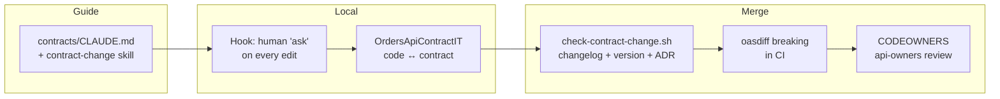
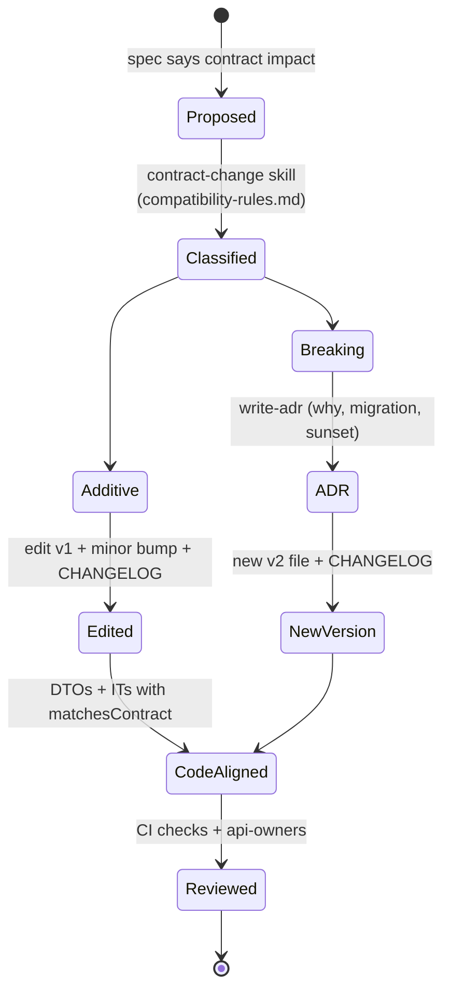

# 07: Contracts: intact but changeable

A contract is anything other teams or systems depend on: HTTP APIs (OpenAPI), events (AsyncAPI/Avro/Protobuf),
database schemas that others read, and public Java APIs of shared libraries. The risk with an AI assistant is
not malice. It's **path of least resistance**: when a test fails because the response doesn't match the spec,
editing the spec is the shortest way to green.

The design goal: **the contract can't drift by accident, but it can evolve on purpose.**

## Where the contract lives

```
contracts/
├── CLAUDE.md                  # nested memory: rules shown only when working here
├── CHANGELOG.md               # every change, classified additive/breaking
└── openapi/
    └── orders-api.v1.yaml     # source of truth; v2 would be a *new file*
```

Keep contracts in a **dedicated top-level folder**, not inside `src/main/resources`, so that:
ownership (CODEOWNERS), hooks and CI checks can target it by path, and consumers can find it.

## Five layers of protection



| Layer | File | Stops |
|---|---|---|
| Guidance | [`contracts/CLAUDE.md`](../contracts/CLAUDE.md), [`contract-change` skill](../.claude/skills/contract-change/SKILL.md) | Claude not knowing the process |
| Human in the loop | [`protect-contracts.sh`](../.claude/hooks/protect-contracts.sh) (`ask`) | silent edits |
| Code follows contract | [`OrdersApiContractIT`](../src/integrationTest/java/com/example/orders/api/OrdersApiContractIT.java) with `matchesContract()` | code drifting from the spec, in both directions |
| Process | [`scripts/check-contract-change.sh`](../scripts/check-contract-change.sh) | unversioned or unrecorded changes |
| Compatibility | `oasdiff breaking` job in [`ci.yml`](../.github/workflows/ci.yml) | breaking changes disguised as minor |
| Ownership | [`.github/CODEOWNERS`](../.github/CODEOWNERS) | merging without an API owner |

## How the contract test works

Every integration test response is validated against the OpenAPI file:

```java
private static ResultMatcher matchesContract() {
    return openApi().isValid("contracts/openapi/orders-api.v1.yaml");
}

mvc.perform(post("/api/v1/orders/{id}/cancel", id) …)
   .andExpect(status().isOk())
   .andExpect(matchesContract());   // status code, content type, schema, additionalProperties:false
```

`additionalProperties: false` in the schemas means that **adding a field in code without adding it to the contract fails the build**.
You can check this yourself: remove `CANCELLED` from the `status` enum in the YAML and run `./gradlew integrationTest`.
`OrdersApiContractIT` fails with `validation.response.body.schema.enum`.

> **Gradle gotcha:** the test reads the YAML from disk, so `build.gradle.kts` declares `contracts/` as an input of the
> `integrationTest` task (`inputs.dir("contracts")`). Without that, a contract-only change counts as "up to date" and
> is served from the build cache, and drift goes unnoticed. Declare every file a test reads at runtime as an input.

## Changing the contract (the happy path)



A real example in this repo: **1.0.0 → 1.1.0** added `POST /orders/{id}/cancel` and the optional `cancellationReason`
field. See [`contracts/CHANGELOG.md`](../contracts/CHANGELOG.md), [ADR-0003](adr/0003-order-cancellation.md) and
[spec ORD-002](specs/ORD-002-cancel-order.md).

### Prompts that work

- "Implement ORD-002. It has contract impact. Use the contract-change skill first and stop after classification so I can confirm."
- "The contract test fails on `total`. Fix the **code** to match the contract. Don't touch `contracts/`."
- "Use the contract-guardian agent to review the contract diff on this branch."

## Other contract types

The same pattern works everywhere: *folder + nested CLAUDE.md + ask-hook + verification test + CI diff tool + CODEOWNERS*.

| Contract | Verification test | CI diff tool |
|---|---|---|
| OpenAPI | swagger-request-validator (this repo) | oasdiff |
| Kafka/Avro | schema compatibility test against the registry | Schema Registry compatibility check |
| Protobuf/gRPC | generated-stub compile + tests | `buf breaking` |
| DB schema | Flyway/Liquibase migrations + Testcontainers IT | migration lint (e.g. squawk for Postgres) |
| Java library API | consumer-facing tests | `japicmp` Gradle plugin / `revapi` |
| Consumer-driven | Spring Cloud Contract / Pact | Pact broker `can-i-deploy` |
