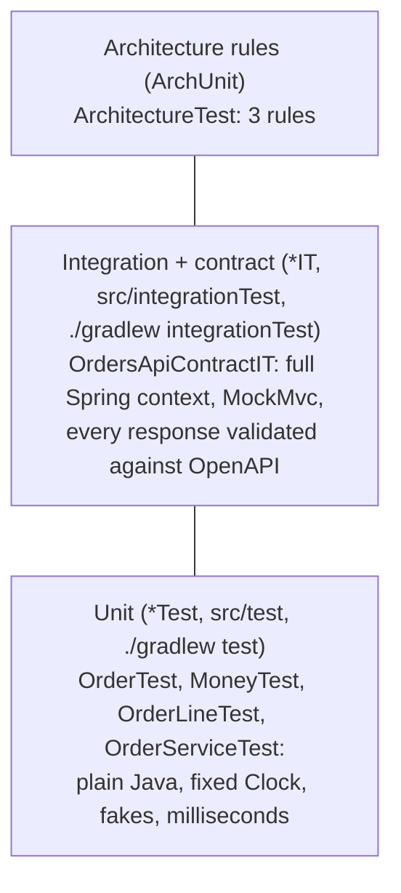
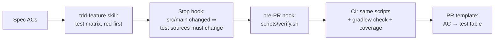

# 08: Testing strategy: tests before the PR

Tests are the feedback loop that lets Claude check its own work. Without them, you're the test suite.
This repo makes "tested" a **mechanical fact**, not a promise.

## The pyramid in this repo



| Kind | Location / naming | Runs in | Scope | Speed |
|---|---|---|---|---|
| Unit | `src/test`, `*Test` | `./gradlew test` | domain + application, no Spring | ms |
| Integration + contract | `src/integrationTest`, `*IT` | `./gradlew integrationTest` (JVM test suite) | HTTP → controller → service → domain → repo | seconds |
| Architecture | `ArchitectureTest` | `./gradlew test` | package dependencies | seconds |
| Coverage gate | `jacocoTestCoverageVerification` | `./gradlew check` | merged unit + IT, ≥80% line / ≥70% branch | — |

Unit and integration tests are separate Gradle [JVM test suites](https://docs.gradle.org/current/userguide/jvm_test_suite_plugin.html)
(`testing { suites { … } }` in `build.gradle.kts`), each with its own source set and dependencies. Spring and the
contract validator are never on the unit-test classpath, so a unit test *can't* accidentally boot Spring.
For real databases or brokers, add Testcontainers-based `*IT`s to the same suite. The pattern stays the same.

## How "tests before the PR" is enforced



1. **Skill** ([`tdd-feature`](../.claude/skills/tdd-feature/SKILL.md)) sets the order: AC list → test matrix → failing test → code.
2. **Stop hook** ([`require-tests-on-stop.sh`](../.claude/hooks/require-tests-on-stop.sh)): Claude can't finish a turn with
   production changes and no test changes.
3. **Pre-PR hook** ([`pre-pr-gate.sh`](../.claude/hooks/pre-pr-gate.sh)): `git push` / PR creation is blocked unless
   `scripts/verify.sh` is green (unit + IT + architecture + coverage).
4. **CI** ([`ci.yml`](../.github/workflows/ci.yml)): the same scripts, so nobody (human or AI) can skip them locally.
5. **Review**: the PR template requires an AC → unit test → IT table.

## Traceability: acceptance criteria ↔ tests

Name tests after acceptance criteria so reviewers (and Claude) can check completeness by reading names:

```java
/** Acceptance criteria from docs/specs/ORD-002-cancel-order.md. */
@Nested
class Cancel {
    @Test void ac1_placedOrderBecomesCancelledAndKeepsReason() { … }
    @Test void ac2_shippedOrderCannotBeCancelled() { … }
    @Test void ac3_cancelledOrderCannotBeCancelledAgain() { … }
    @Test void ac4_reasonIsRequired() { … }
}
```

## Test-quality rules Claude must follow

Encoded in [`.claude/rules/testing.md`](../.claude/rules/testing.md), which loads only when touching `src/test/**` or `src/integrationTest/**`:

- Assert **behaviour**, not implementation (no verifying mock call counts for things with observable results).
- Hand-written fakes for ports (`FakeOrderRepository`) over Mockito.
- Fixed `Clock`. No sleeps, no wall time, no network.
- **Never** delete, `@Disabled`, or loosen an assertion to go green. This is the single most important rule for AI-written code.

## Watch-outs specific to AI-written tests

| Smell | Countermeasure |
|---|---|
| Tests written *after* the code that just mirror it | the `tdd-feature` skill: confirm red first, and paste the failure message in the plan |
| Only happy paths | the AC matrix must include every error status in the contract (400/404/409) |
| Over-mocking | the rule prefers fakes. The `code-reviewer` agent flags mock-heavy tests |
| Weakened assertions to pass | rule + reviewer + CODEOWNERS on test infrastructure |
| Coverage gaming (asserting nothing) | branch coverage plus review of the AC→test table. Consider mutation testing (PIT) for core domain |

Optional next step: add the `info.solidsoft.pitest` Gradle plugin for the `domain` package so Claude's tests are checked for their ability to *kill mutants*, not just to execute lines.
