# 09: PR workflow and CI

## End-to-end flow

```mermaid
flowchart LR
    Spec["Spec Ready<br/>docs/specs/ORD-xxx"] --> Plan["Plan mode<br/>files + test matrix"]
    Plan -->|human approves| Branch[branch ORD-xxx-…]
    Branch --> TDD[tdd-feature<br/>red → green → refactor]
    TDD --> Ready[pr-ready skill]
    Ready --> Review[code-reviewer agent]
    Review --> Gate[pre-PR hook<br/>scripts/verify.sh]
    Gate --> PR[PR from template]
    PR --> CI[CI: verify + contract checks + oasdiff]
    CI --> Human[human review<br/>CODEOWNERS]
    Human --> Merge
```

## Local gate = CI gate

[`scripts/verify.sh`](../scripts/verify.sh) runs:

1. `check-tests-present.sh`: production changes come with test changes
2. `check-contract-change.sh`: contract edits are versioned, recorded, and have an ADR if needed
3. `./gradlew check`: compile, unit tests, ITs + contract validation, ArchUnit, JaCoCo gate

[`ci.yml`](../.github/workflows/ci.yml) runs the **same scripts**, plus an `oasdiff` compatibility job. Because the hook
runs the gate before `git push`, CI failures on Claude-authored PRs become rare, and a CI failure means something
environmental, not "Claude forgot".

## The PR template as a checklist Claude fills in

[`.github/pull_request_template.md`](../.github/pull_request_template.md) asks for:
what/why + spec link, **AC → unit test → IT table**, contract impact classification, how it was verified,
docs/diagram/ADR updates, and follow-ups (the scope-creep outlet).

The `pr-ready` skill instructs Claude to fill every section and leave no placeholders. Reviewers start from a
consistent, scannable description.

## Review in layers

| Layer | Who | Looks for |
|---|---|---|
| Machine | CI | build, tests, coverage, architecture, contract compat |
| AI self-review | `code-reviewer` subagent | spec conformance, test quality, scope, docs |
| AI contract review | `contract-guardian` subagent | compatibility + process for `contracts/` |
| Human | CODEOWNERS | intent, design, risk, business correctness |

Humans review *intent and risk*. Machines check the things machines are better at.

## Optional: Claude in CI

- **GitHub Action** (`anthropics/claude-code-action`): respond to `@claude` in PRs and issues, or run an automated review
  using the same `.claude/` config and `CLAUDE.md` as local sessions.
- **Headless**: `claude -p "Use the contract-guardian agent on this PR's diff and output the verdict" --output-format json`
  as a CI step, posting the result as a PR comment.

Keep CI Claude **read-only or comment-only** unless you've reviewed exactly what it can push.

## Branch and commit conventions

- Branch: `ORD-002-cancel-order`
- Commits: `ORD-002: add cancel endpoint to contract (1.1.0)`, `ORD-002: domain rule + tests`, …
  Small commits make Claude's work reviewable and easy to revert.
