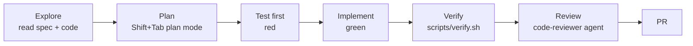

# 11: Playbook: Java developers

A day-to-day guide, with ORD-002 (cancel order) as the worked example. Everything described here happened in this repo.
See the spec, tests, contract diff and ADR.

## The loop



## Worked example: ORD-002

**1. Start a fresh session and explore, without coding yet**
```
Read docs/specs/ORD-002-cancel-order.md and the Order aggregate. Summarise the ACs and say whether
the contract must change. Don't write code yet.
```
Claude sees the root `CLAUDE.md` only. It opens the spec and `Order.java` on demand, and `.claude/rules/java.md` loads because it touched a `src/main` Java file.

**2. Plan (plan mode)**
```
Plan ORD-002 with the tdd-feature skill. Include the test matrix. Contract impact: use contract-change.
```
You review a plan that lists: contract change (additive, 1.0.0 → 1.1.0), `Order.cancel`, `OrderService.cancelOrder`,
the endpoint, `CancelOrderRequest`, `cancellationReason` in `OrderResponse`, and an AC → test table. **This is the cheapest moment to correct Claude.**

**3. Contract first**
Claude edits `orders-api.v1.yaml`. The hook asks **you** to approve the contract edit. It bumps `info.version`,
adds the CHANGELOG entry, and drafts ADR-0003.

**4. Red → green**
Unit tests `OrderTest.Cancel.ac1…ac4` fail first. Then `Order.cancel()` makes them pass. Then the ITs with `matchesContract()`,
then the controller. `./gradlew test` in the loop, `./gradlew check` at the end.

**5. Ready**
```
/pr-ready
```
The gate runs, `code-reviewer` returns MUST FIX / SHOULD FIX, and the PR description comes out filled in with the AC table.

**6. Push**
`git push` triggers the pre-PR hook. If something is red, Claude sees the filtered failure and fixes it before anything leaves your machine.

## Prompt patterns that work

| Situation | Prompt |
|---|---|
| New feature | "Implement ORD-123 using tdd-feature. Stop after the plan." |
| Bug | "Write a failing test that reproduces #456 first, show me the failure, then fix it." |
| Failing contract test | "OrdersApiContractIT fails on `total`. Fix the code, not the contract." |
| Big codebase question | "Use an explore agent to find all places that construct `OrderResponse`. Report file:line only." |
| Refactor | "Refactor X without changing behaviour. All existing tests must pass unmodified." |
| Review | "Use the code-reviewer agent on this branch." |
| Long session | "/compact keep the AC list, the test matrix and the currently failing test" |

## Habits

- **One task per session.** `/clear` between tasks. Put durable knowledge in specs and ADRs, not in chat history.
- **Interrupt early** (Esc) when the plan or first edit goes the wrong way. Don't wait for it to finish.
- **Read the diff.** You own the code Claude writes. The gate proves it works. Your review proves it's right.
- **Improve the system, not the prompt.** If you correct Claude on the same thing twice, add a rule, a test or a hook,
  and commit it so the whole team benefits.
- **Keep personal preferences personal:** `~/.claude/CLAUDE.md` or `CLAUDE.local.md`, not the team file.

## Large-codebase tips (multi-project Gradle builds)

- Put a short `CLAUDE.md` in each module that matters (purpose, owner, module-specific commands like `./gradlew :orders-core:test`).
- Scope rules with `paths:` per module.
- Give the fast loop per module: `./gradlew :<module>:test` so Claude doesn't run a 20-minute build for a one-line change.
- Keep the build fast and cacheable: build cache, configuration cache and parallel execution are enabled in
  `gradle.properties`. A quick feedback loop matters more for Claude than for humans, because Claude runs it far more often.
- Share versions via a version catalog (`gradle/libs.versions.toml`) and conventions via `buildSrc` or an included
  build, so Claude edits one place instead of 40 build files.
- Run Claude from the repo root so the hierarchy loads correctly, and use `/add-dir` for sibling repos.
- For repo-wide changes, have a plan written to a file (`docs/plans/…md`) and executed module by module in separate sessions.
