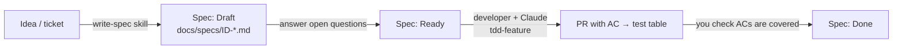

# 12: Playbook: project managers

Claude doesn't only write code. It's also good at turning conversations into **precise, testable specs**, and precise
specs are the biggest single lever on the quality of AI-written code. Vague input produces confident but wrong output.

## Your part of the system



| You own | Where | Why it matters to Claude |
|---|---|---|
| Acceptance criteria | `docs/specs/<ID>-*.md` | each AC becomes named tests (`ac1_…`), which is what "done" means |
| Out of scope | same file | the main defence against Claude "helpfully" building more |
| Spec status | same file | Claude is told to implement only `Ready` specs |
| Contract impact (with the tech lead) | same file | triggers the contract process early, not at review |

## Writing a spec with Claude

```
Use the write-spec skill. The idea: customers can cancel orders that haven't shipped;
support needs the reason. Interview me about gaps before writing.
```

Claude will ask about error cases, permissions and limits, then write
[`docs/specs/ORD-002-cancel-order.md`](specs/ORD-002-cancel-order.md) in the [template](../.claude/skills/write-spec/template.md) format.

### A good acceptance criterion…

| ✗ Vague | ✓ Testable |
|---|---|
| Users can cancel orders | Given a `PLACED` order, when cancelled with a reason, then status is `CANCELLED` and the reason is stored |
| Shipped orders can't be cancelled | Given a `SHIPPED` order, when cancelled, then 409 and the order is unchanged |
| It should be fast | p95 latency < 200 ms at 50 req/s in the staging load test |

## Reviewing a PR without reading Java

1. Open the PR description and find the **AC → test table**. Every AC should have a unit test and an integration test.
2. Read the test *names*. They are written to be read as sentences (`ac2_shippedOrderCannotBeCancelled`).
3. Check **Contract impact**. Is it breaking? Then consumers must be informed.
4. Check **Follow-ups / out of scope**. Anything there should become a ticket.

## Other useful PM prompts (no coding needed)

- "Summarise what changed in the Orders API over the last 3 releases, using contracts/CHANGELOG.md."
- "Which specs in docs/specs are Ready but have no merged implementation?"
- "Draft release notes for users from the merged PRs since tag v1.2.0."
- "Explain the order lifecycle in plain language using docs/architecture/overview.md."
- "Compare spec ORD-002 to the tests. Is any acceptance criterion not covered?"
