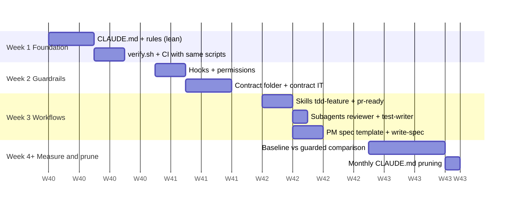

# 13: Adopting in a new project, and measuring the gain

## What to copy

| Copy as-is | Adapt | Project-specific (write your own) |
|---|---|---|
| `.claude/hooks/*` | `.claude/settings.json` (commands in allow list) | `CLAUDE.md` (keep the structure, rewrite the content) |
| `scripts/changed-files.sh`, `check-tests-present.sh`, `check-contract-change.sh` | `scripts/verify.sh` (your build command) | `.claude/rules/*.md` (your conventions) |
| `.claude/skills/*` | `.claude/agents/*` (your review focus) | `contracts/*` |
| `.github/pull_request_template.md` | `.github/CODEOWNERS` (your teams) | `docs/architecture/`, ADRs, specs |
| `docs/adr/template.md`, spec template | `.github/workflows/ci.yml` | |
| `ArchitectureTest` pattern, contract IT pattern | `build.gradle.kts` coverage thresholds, test suites | |

For Maven, replace `./gradlew check` with `mvn -B verify` (surefire for `*Test`, failsafe for `*IT`) in `verify.sh`,
`CLAUDE.md` and the allow list, and change the test paths in `check-tests-present.sh`. The rest is build-agnostic.

## Rollout plan

Start with **commands + the gate**. A reliable `verify.sh` is worth more than any amount of markdown.
Add guidance only in response to observed mistakes.

## Measuring whether it helps

Track a small set of metrics before and after (per PR, from Git/CI data):

| Metric | Source | Expect |
|---|---|---|
| **First-pass CI green rate** | CI runs per PR | ↑ (the local gate catches failures first) |
| **Review rounds per PR** | PR review events | ↓ (reviewer agent + template) |
| **PRs with production changes but no test changes** | `check-tests-present.sh` in CI | → 0 |
| **Unplanned contract changes** | `contracts/` diffs without CHANGELOG/ADR | → 0 |
| **Escaped defects** (bugs found after merge) | issue tracker label | ↓ |
| **Lead time: spec Ready → merged** | spec status + merge date | ↓ |
| Coverage (line/branch), optionally mutation score | JaCoCo / PIT | ↑ or stable at the gate |
| Human corrections per task | short dev survey or session notes | ↓ over the weeks as rules improve |

### A fair comparison

1. Pick 6–10 **representative tasks** (a feature, bug fix, refactor, contract change) of similar size.
2. Run half on a branch **without** `.claude/`, hooks and skills (only a `/init` CLAUDE.md), and half **with** the full setup.
   Swap which half next time.
3. For each task, record: CI green on first push? Tests for every AC? Contract untouched unless intended? Review comments? Time to merge?
4. Look at `/context` at the end of a typical task in both setups. The guarded setup should use *less* always-on context, not more.

### Keep it healthy

- **Monthly pruning:** delete rules Claude follows without being told, and merge duplicates.
- **Every repeated correction** becomes a rule, a test or a hook, reviewed like code.
- **Watch the gate's runtime.** If `verify.sh` gets slow, developers and Claude will look for ways around it.
  Split fast checks (per module) from full checks (pre-push/CI).
