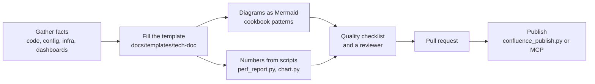

# 14: Technical documentation: architecture docs, performance reports and Confluence

Most architecture documents are written once, by hand, and drift from the system within a quarter. This toolkit makes
Claude produce **professional and reproducible** documents: facts from the code, numbers from scripts, diagrams as text,
published to Confluence from Git.

## What you get

| Skill | Produces | Backed by |
|---|---|---|
| `tech-doc` | an architecture or solution design document: context, container, data-flow, sequence, state, data-model and deployment diagrams; interface, SLO, risk and operations tables | [`docs/templates/tech-doc/architecture.md`](templates/tech-doc/architecture.md), the [diagram cookbook](../.claude/skills/tech-doc/diagram-cookbook.md) and the [quality checklist](../.claude/skills/tech-doc/quality-checklist.md) |
| `perf-report` | a performance test report: results table per scenario, SLO verdicts, time-series charts, analysis and recommendations | [`scripts/docs/perf_report.py`](../scripts/docs/perf_report.py), [`scripts/docs/chart.py`](../scripts/docs/chart.py), [`docs/templates/tech-doc/performance-report.md`](templates/tech-doc/performance-report.md) |
| `confluence-publish` | the same Markdown as a Confluence page with rendered diagrams, a table of contents, page properties and labels | [`scripts/docs/confluence_publish.py`](../scripts/docs/confluence_publish.py) |

The principle: **Markdown and Mermaid in Git are the source of truth; Confluence is a published view.** Documents are
reviewed in pull requests next to the code they describe, diagrams diff, and Claude can read and update them
([topic 10](10-documentation-and-diagrams.md)).

## The workflow



Every step is a numbered step in a skill, so "write the architecture document for X" gives the same shape of document
each time, and reviewers know where to look.

## Diagrams architects ask for

| Question | Diagram | Cookbook pattern |
|---|---|---|
| Who uses the system and what does it depend on? | `flowchart`, C4 context style | System context |
| Which deployable units exist and what runs where? | `flowchart` with `subgraph` | Containers, Deployment |
| What data moves between which parts, how much, how sensitive? | `flowchart` in DFD notation plus a flow table | Data flow |
| What happens on a request, including failures? | `sequenceDiagram` | Key flow |
| Which states can an entity be in? | `stateDiagram-v2` | Lifecycle |
| How is the data shaped? | `erDiagram` | Data model |
| How did a metric behave during the test? | `xychart-beta` on GitHub, `chart.py` image on Confluence | Time series |
| When does the rollout happen? | `gantt` | Timeline |

The rules from topic 10 still hold: derive from code, 12 nodes or fewer, update in the same pull request.

## Performance results, reproducibly

```bash
# 1. results table, SLO verdict and time series from JMeter JTL, k6 summary JSON, k6 CSV or any CSV
python3 scripts/docs/perf_report.py results.jtl --title "Orders API, 50 req/s" \
    --slo "p95<=300,p99<=800,error_rate<=1" --bucket 60 \
    --series-csv docs/performance/images/p95.csv --out build/docs/results.md

# 2. a chart for Confluence (SVG, plus PNG with --png); the Mermaid chart in results.md renders on GitHub
python3 scripts/docs/chart.py docs/performance/images/p95.csv --out docs/performance/images/p95.svg \
    --title "p95 latency, Orders API" --y-label ms --threshold 300 --threshold-label "SLO 300 ms" --png

# 3. throughput or error rate over time: same script, another metric
python3 scripts/docs/perf_report.py results.jtl --series-metric throughput --series-csv docs/performance/images/throughput.csv --out /dev/null
```

Worked example: [docs/examples/perf/orders-api-sample-report.md](examples/perf/orders-api-sample-report.md) was
generated from [orders-api-sample.jtl](examples/perf/orders-api-sample.jtl), a synthetic data set in which one
scenario breaks its SLO on purpose. The script prints its method (nearest-rank percentiles, the throughput formula, how
errors are counted) under the table so a reviewer can check the numbers.

Chart rules the scripts follow and the checklist asks for: one measure per chart and one y-axis (never a dual axis), a
labelled threshold line for the SLO, a legend for two or more series, a fixed colour order that passes colour-vision
checks, and the same data available as a table (`chart.py --table`).

## Publishing to Confluence

Three routes, in order of preference:

1. **Atlassian MCP server**, so Confluence tools exist inside Claude Code. Add it once with
   `claude mcp add --transport sse atlassian https://mcp.atlassian.com/v1/sse`, then run `/mcp` to log in
   (see [`docs/templates/mcp.json`](templates/mcp.json); check Atlassian's current documentation for the URL). Claude
   creates or updates the page from the Markdown. Diagram images still go through the script or by hand.
2. **The REST script**, `scripts/docs/confluence_publish.py`: converts Markdown to Confluence storage format, renders
   Mermaid to PNG with mermaid-cli, creates or updates the page (Cloud API v2, or `--api v1` for Data Center and
   Server), uploads attachments and sets labels. Always run `--dry-run` first and read `build/docs/<name>/page.storage.xml`.
3. **Manual paste**: the Cloud editor converts pasted Markdown (headings, lists, tables, code); drag the rendered
   images in.

What the converter handles: headings, paragraphs, emphasis, inline code, links, images, nested lists, task lists, tables,
fenced code (code macro with language), Mermaid blocks (rendered image), GitHub alerts such as `> [!NOTE]` and
`> [!WARNING]` (info and warning panels), `[[TOC]]`, and HTML comments, which are dropped so template guidance never
reaches the page. Useful options: `--page-properties` turns the first table into a Page Properties macro (the page then
appears in Page Properties Reports), `--labels`, `--toc`, and `--link-base` to make relative links point at the
repository.

Mermaid is not native in Confluence. The script renders diagrams to PNG; alternatives are a Mermaid macro from the
Marketplace, or draw.io inside Confluence (Arrange → Insert → Advanced → Mermaid gives an editable diagram).

Confluence page templates: once a published page looks right, a space admin can save its body as a space template
(Space settings → Templates). The Markdown templates in this repo stay the source; the Confluence template is a
convenience for people who start in Confluence.

## Prompts to try

- "Use the tech-doc skill: write the architecture document for orders-service from the code. Audience: new engineers
  and on-call. Show me the outline before filling it."
- "Use the perf-report skill on results/2026-10-18.jtl with SLO p95<=300,p99<=800,error_rate<=1. Compare with
  docs/performance/orders-2026-09-01.md and explain the regression."
- "Draw the data-flow diagram for order cancellation from the code, with the flow table."
- "Publish docs/architecture/orders-service.md to Confluence space ARCH under page 123456. Dry run first and show me
  the warnings."

## Requirements

- Python 3.9 or newer; the scripts use only the standard library.
- Diagrams to images: Node.js and mermaid-cli (`npm install -g @mermaid-js/mermaid-cli`), or `--mermaid-cmd "npx -y -p @mermaid-js/mermaid-cli mmdc"`.
- Charts to PNG (Confluence Data Center): the `cairosvg` package, librsvg, Inkscape, or Chrome; Cloud displays the SVG.
- Confluence: an API token (Cloud) or personal access token (Data Center) in environment variables, never in files.

## Where things live

| Path | Contents |
|---|---|
| `.claude/skills/tech-doc/` | the skill, [quality-checklist.md](../.claude/skills/tech-doc/quality-checklist.md), [diagram-cookbook.md](../.claude/skills/tech-doc/diagram-cookbook.md) |
| `.claude/skills/perf-report/`, `.claude/skills/confluence-publish/` | the report and publishing skills |
| `docs/templates/tech-doc/` | [architecture.md](templates/tech-doc/architecture.md), [performance-report.md](templates/tech-doc/performance-report.md) |
| `scripts/docs/` | `perf_report.py`, `chart.py`, `confluence_publish.py` |
| `docs/examples/perf/` | sample JTL and the report generated from it |
| `docs/architecture/`, `docs/performance/` | where the documents you write go |
