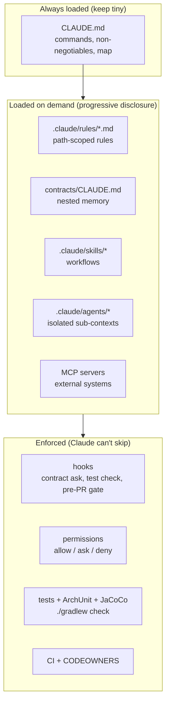

# Guiding Claude Code on large projects: the guide

This repo is a working **reference implementation**. Each topic below has a guide in `docs/` and real files
in this repo that you can read, run and copy.

## The mental model

Claude works best with **small, precise, always-true context** and **hard feedback loops** it can't talk
its way around. Everything in this repo belongs to one of these layers:

> **Rule of thumb:** *guidance* goes in markdown. *Guarantees* go in hooks, tests and CI.
> If breaking a rule would hurt, don't just write it down. Enforce it.

## Topics

| # | Guide | Example files in this repo |
|---|-------|----------------------------|
| 01 | [Context engineering: signal vs noise](01-context-engineering.md) | the whole layout |
| 02 | [CLAUDE.md, nested memory and rules](02-claude-md-and-rules.md) | `CLAUDE.md`, `contracts/CLAUDE.md`, `.claude/rules/` |
| 03 | [Skills: reusable workflows](03-skills.md) | `.claude/skills/*/SKILL.md` |
| 04 | [Subagents: isolated context](04-subagents.md) | `.claude/agents/*.md` |
| 05 | [Hooks and permissions: guardrails](05-hooks-and-permissions.md) | `.claude/settings.json`, `.claude/hooks/` |
| 06 | [MCP servers and tools](06-mcp-and-tools.md) | `docs/templates/mcp.json` |
| 07 | [Contracts: intact but changeable](07-contracts.md) | `contracts/`, `OrdersApiContractIT` |
| 08 | [Testing strategy: tests before the PR](08-testing-strategy.md) | `src/test/`, `src/integrationTest/`, `build.gradle.kts` |
| 09 | [PR workflow and CI](09-pr-workflow-and-ci.md) | `.github/`, `scripts/verify.sh` |
| 10 | [Documentation and diagrams](10-documentation-and-diagrams.md) | `docs/architecture/`, `docs/adr/` |
| 11 | [Playbook: Java developers](11-playbook-java-developers.md) | worked example: ORD-002 |
| 12 | [Playbook: project managers](12-playbook-project-managers.md) | `docs/specs/` |
| 13 | [Adopting in a new project and measuring the gain](13-adopting-and-measuring.md) | copy list + metrics |

## Reading paths

- **Java developer, first day:** 01 → 02 → 08 → 07 → 11
- **Tech lead setting up a repo:** 01 → 02 → 05 → 03 → 04 → 09 → 13
- **Project / product manager:** 01 (first half) → 12 → 07 (the "why") → 13 (metrics)

## The demo project

`orders-service`: a Spring Boot 4.1 / Java 25 service built with Gradle 9 with a contract-first Orders API
(`contracts/openapi/orders-api.v1.yaml`). Architecture: [architecture/overview.md](architecture/overview.md).
Run everything with `scripts/verify.sh`. Build choices: [ADR-0004](adr/0004-gradle-java25-spring-boot-4.md).

> Claude Code changes quickly. File names and formats here match the current docs
> (https://code.claude.com/docs). Check `/help`, `/memory`, `/hooks` and `/agents` in your version if something differs.
