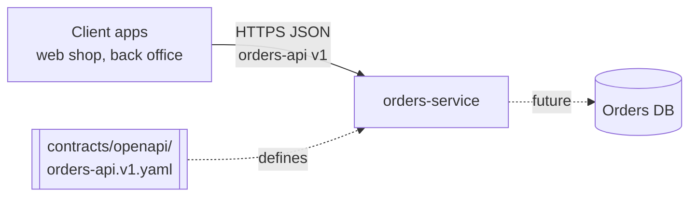
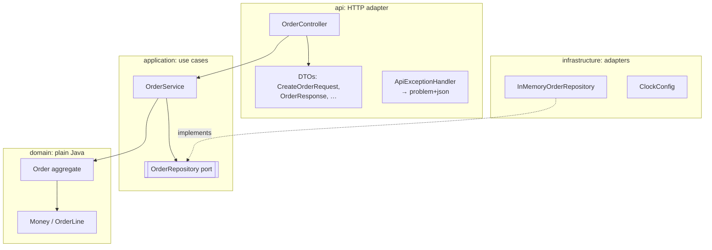
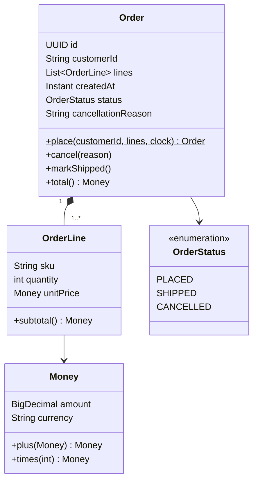
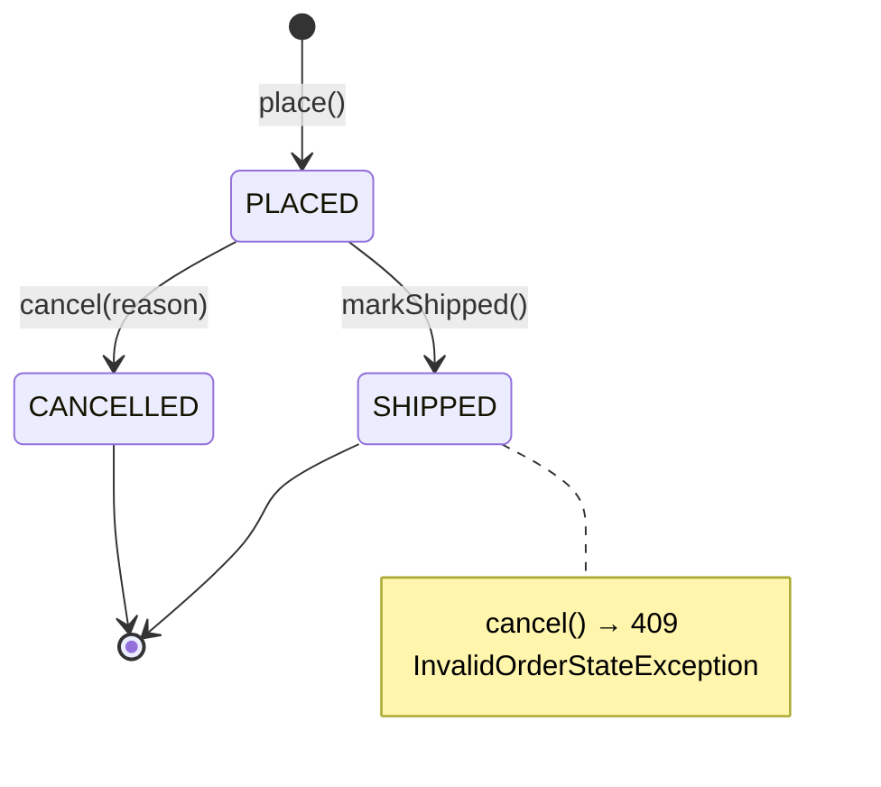
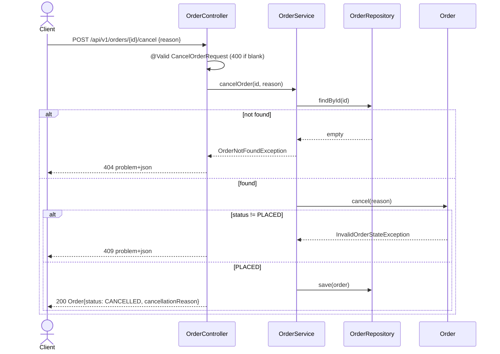

# Architecture overview: orders-service

Enforced by [`ArchitectureTest`](../../src/test/java/com/example/orders/architecture/ArchitectureTest.java).
If this doc and that test disagree, the test wins. Fix the doc.

## Context

## Layers

| Rule | Why |
|---|---|
| `domain` depends on nothing (no Spring, no Jakarta) | trivially unit-testable, portable |
| Business rules live in `Order` | one place to read, test and change them |
| `application` owns the `OrderRepository` port, `infrastructure` implements it | swap in-memory for JPA without touching the core |
| `api` DTOs mirror the OpenAPI contract | `OrdersApiContractIT` checks every response |
| Only `api` and `infrastructure` know about the outside world | adapters at the edges |

## Domain model

## Order lifecycle

Matches the transitions in `Order` and the tests in `OrderTest`.

## Cancel order flow (ORD-002)

