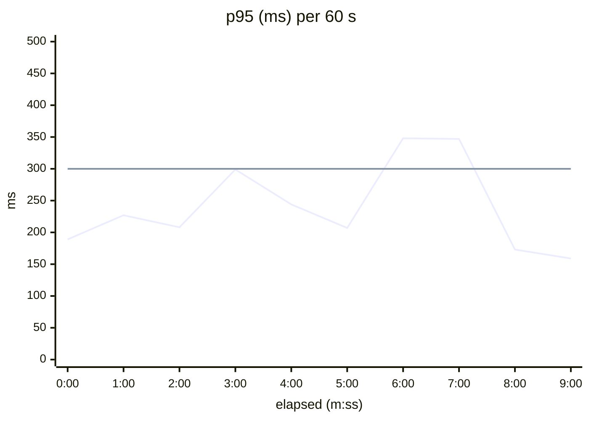

# Example: performance results generated from a JMeter JTL

Generated with `python3 scripts/docs/perf_report.py docs/examples/perf/orders-api-sample.jtl --title "Orders API, 2 virtual users with think time, 10 min (sample data)" --slo "p95<=300,p99<=800,error_rate<=1" --bucket 60 --heading-level 2`. The data is synthetic (see [docs/14-technical-documentation.md](../../14-technical-documentation.md)); the POST scenario slows down in minutes 6 to 7 on purpose, so the SLO verdict shows a failure. The chart renders on GitHub; for Confluence, render the same series with `scripts/docs/chart.py`.

## Results: Orders API, 2 virtual users with think time, 10 min (sample data)

Source: docs/examples/perf/orders-api-sample.jtl (jtl), 400 samples, 2025-10-09 08:53:20 UTC to 2025-10-09 09:03:17 UTC (9:57 min:sec).

| Scenario | Requests | Errors | Error % | Throughput (req/s) | Avg (ms) | p50 (ms) | p90 (ms) | p95 (ms) | p99 (ms) | Max (ms) | SLO |
|---|---|---|---|---|---|---|---|---|---|---|---|
| GET /api/v1/orders/{id} | 200 | 1 | 0.50 | 0.3 | 57 | 55 | 84 | 93 | 115 | 149 | ✅ PASS |
| POST /api/v1/orders | 200 | 0 | 0.00 | 0.3 | 177 | 152 | 296 | 327 | 467 | 785 | ❌ FAIL (p95<=300) |
| **All** | 400 | 1 | 0.25 | 0.7 | 117 | 85 | 241 | 296 | 348 | 785 | ✅ PASS |

**SLO verdict: FAIL** against `p95<=300, p99<=800, error_rate<=1` (failing scenarios marked in the table).

*Figure: p95 over elapsed time, All. The flat line is the SLO (300 ms).*

Method: percentiles are nearest-rank over all samples of a scenario; throughput is requests divided by the scenario's first-to-last sample span; errors are samples flagged unsuccessful by the tool.
