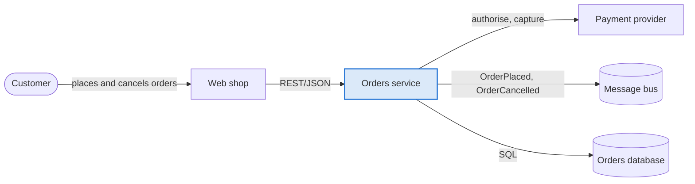
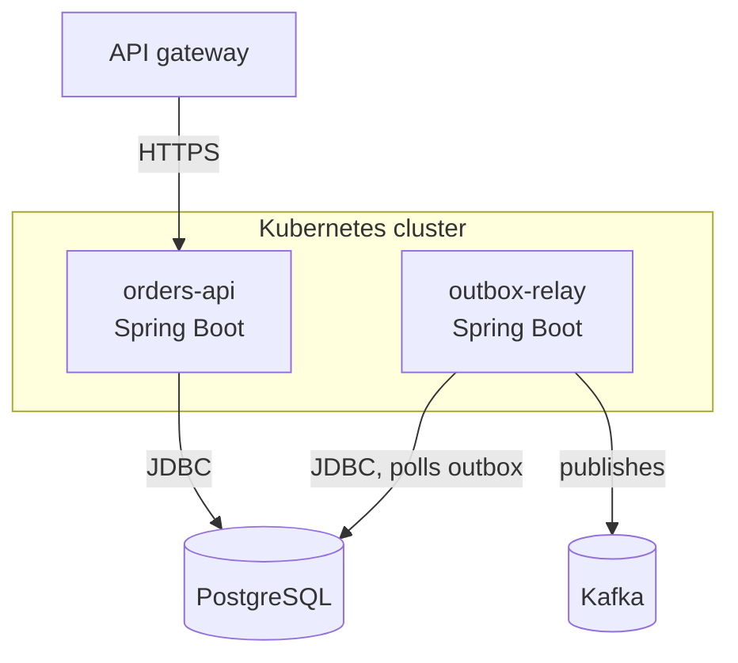
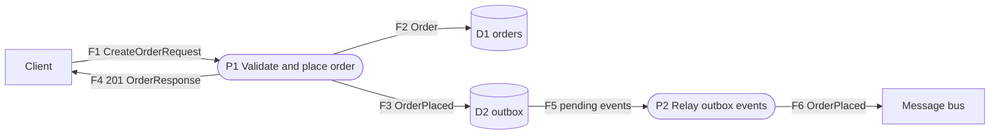
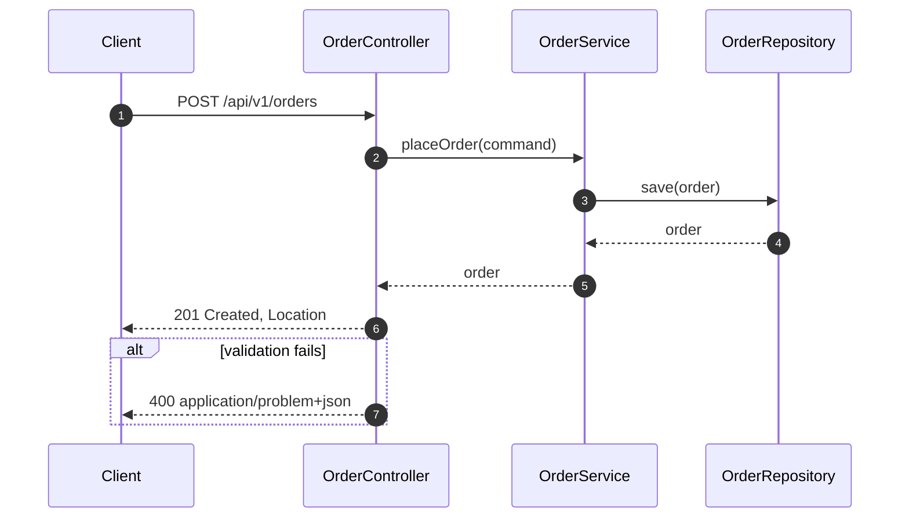
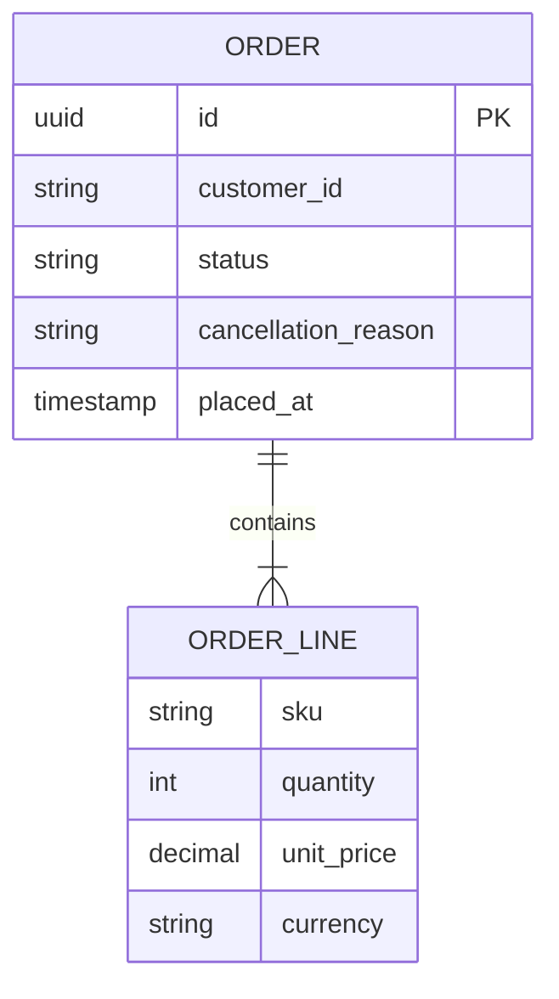
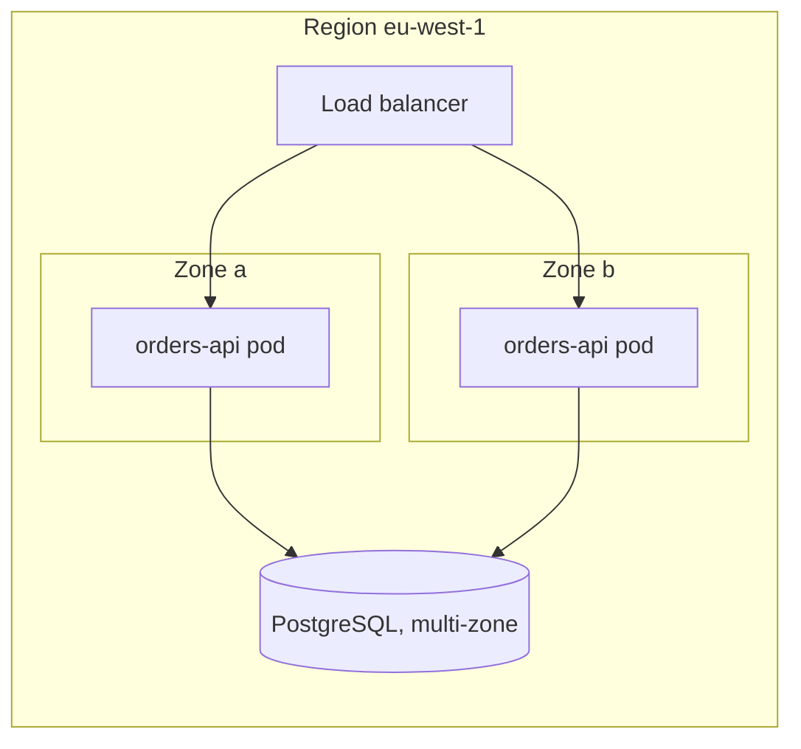

# <System or feature>: architecture

<!--
How to use this template (these HTML comments are guidance; scripts/docs/confluence_publish.py drops them):
- Copy to docs/architecture/<system>.md or docs/design/<TICKET>-<topic>.md. Fill every section or delete it. Never ship
  placeholder text or an empty heading.
- Derive facts from the code, configuration and infrastructure definitions. Mark what you could not verify as
  "TBD (owner)" and list it under Open questions.
- Aim for six pages or fewer. Details belong in ADRs (decisions), specs (requirements) and runbooks (operations); link them.
- Every diagram gets a one-line caption that states its takeaway. Every table has units and a source.
-->

| Field | Value |
|---|---|
| Status | Draft / In review / Approved / Superseded by <link> |
| Owner | @name (team) |
| Reviewers | @name, @name |
| Last updated | YYYY-MM-DD |
| Version | 0.1 |
| Related | ADR-00NN, spec <ID>, epic <KEY-123>, runbook <link> |
| Audience | engineers on the team, reviewers, on-call |

[[TOC]]

## 1. Summary

<!-- Five sentences at most: what the system does, for whom, the two or three decisions that shape it, and the current
status. A reader who stops here should know what it is and whether it concerns them. -->

## 2. Context and goals

### Business context

<!-- Why this exists, which product capability or problem it serves, who the stakeholders are. -->

### Goals

- <measurable goal, e.g. "customers can cancel an unshipped order within 1 s">

### Non-goals

- <what this deliberately does not do, and where that is handled instead>

### Constraints and assumptions

| Constraint or assumption | Source | Impact on the design |
|---|---|---|
| <e.g. must run on the shared Kubernetes platform> | platform team | <e.g. no stateful sidecars> |

## 3. System context

<!-- C4 level 1: the system as one box, with the people and systems around it. Keep it to 12 nodes or fewer. -->

*Figure 1: system context. The orders service owns order state; payment and messaging are external dependencies.*

| External system | Direction | Protocol and format | Data exchanged | Owner | SLA and notes |
|---|---|---|---|---|---|
| Web shop | inbound | HTTPS, JSON (orders-api v1) | orders, cancellations | shop team | p95 ≤ 300 ms expected |
| Payment provider | outbound | HTTPS, JSON | authorisation, capture | vendor | 99.9 %, 2 s timeout, retried |
| Message bus | outbound | Kafka, Avro | OrderPlaced, OrderCancelled | platform | at-least-once |

## 4. Architecture overview

<!-- C4 level 2: deployable units (containers) and their responsibilities. One box per process or datastore. -->

*Figure 2: containers. The API never publishes directly; the outbox relay makes publishing transactional.*

| Container or component | Responsibility | Technology | Owner |
|---|---|---|---|
| orders-api | HTTP API, validation, order state machine | Java 25, Spring Boot 4 | orders team |
| outbox-relay | publishes committed events from the outbox table | Java 25, Spring Boot 4 | orders team |
| PostgreSQL | system of record for orders | PostgreSQL 16, managed | platform |

### Design principles and key decisions

- <principle or decision, e.g. "contract first: the OpenAPI file is the source of truth"> (ADR-0002)
- <e.g. "business rules live in the domain aggregate, enforced by ArchitectureTest">

## 5. Data flow

<!--
Level-1 data flow diagram. Notation: external entities are rectangles, processes are stadium shapes numbered P1..Pn,
data stores are cylinders numbered D1..Dn, and every arrow is labelled with the data that moves (F1..Fn).
Every flow in the diagram gets a row in the table; the table is where volume, format and classification live.
-->

*Figure 3: placing an order. F2 and F3 are written in one transaction, which is what makes F6 reliable.*

| Flow | From → To | Data (schema or contract) | Protocol and format | Volume and frequency | Classification | Consistency and retry |
|---|---|---|---|---|---|---|
| F1 | Client → P1 | CreateOrderRequest (orders-api v1) | HTTPS, JSON | 50 req/s peak, 2 KB | internal, contains customer id | idempotent via Idempotency-Key |
| F2 | P1 → D1 | Order | SQL | 1 row per order | PII: customer id | transactional with F3 |
| F6 | P2 → bus | OrderPlaced v1 | Kafka, Avro | 1 event per order | internal | at-least-once, consumers dedupe |

## 6. Key flows

<!-- One sequence diagram per important or risky scenario: the happy path and its main failure. Use the names from the code. -->

*Figure 4: place order. Validation happens before any write, so a 400 never leaves partial state.*

## 7. Data model

*Figure 5: logical model. Status transitions are enforced in the Order aggregate, not in the database.*

| Entity | Owner | Retention | Personal data | Notes |
|---|---|---|---|---|
| Order | orders service | 7 years (legal) | customer id (pseudonymous) | migrations via Flyway |

## 8. Interfaces and contracts

| Interface | Type | Contract (source of truth) | Version and compatibility | Auth | Idempotency and errors |
|---|---|---|---|---|---|
| Orders API | HTTP REST | `contracts/openapi/orders-api.v1.yaml` | 1.1.0, additive changes only within v1 | gateway JWT | Idempotency-Key header; RFC 9457 problem+json |
| OrderPlaced | event | <schema registry link> | v1 | n/a | consumers must dedupe on order id |

## 9. Quality attributes and SLOs

<!-- Only attributes with a number and a way to measure them. Link the evidence (dashboards, the performance report). -->

| Attribute | Requirement (SLO) | How it is measured | Current status and evidence |
|---|---|---|---|
| Latency | p95 ≤ 300 ms, p99 ≤ 800 ms at 50 req/s | gateway metrics; load test | <link to performance report> |
| Availability | 99.9 % per month | synthetic checks | <dashboard link> |
| Throughput | 50 req/s sustained, 150 req/s peak for 10 min | load test | <report link> |
| Durability | no acknowledged order lost | outbox + consumer reconciliation | <audit job link> |
| Recovery | RTO 30 min, RPO 5 min | DR drill | <drill report> |

## 10. Security and compliance

| Topic | Approach |
|---|---|
| Authentication and authorisation | <e.g. gateway-issued JWT, scopes per endpoint> |
| Data classification | <what is PII, where it is stored, encryption at rest and in transit> |
| Secrets | <where they live, rotation> |
| Audit | <what is logged, retention> |

| Threat | Mitigation | Status |
|---|---|---|
| <e.g. replayed requests create duplicate orders> | Idempotency-Key, unique constraint | done |

## 11. Deployment and infrastructure

*Figure 6: deployment. Two zones; the database fails over automatically.*

| Environment | Purpose | Sizing | Data | Differences from production |
|---|---|---|---|---|
| dev | feature work | 1 pod, shared DB | synthetic | no gateway auth |
| staging | integration and load tests | 2 pods, 1 vCPU each | anonymised copy | smaller DB instance |
| production | live traffic | 3 to 10 pods (autoscaled) | real | n/a |

<!-- Also: configuration and feature flags, scaling rules, release process, rollback. -->

## 12. Observability and operations

| Signal | Source | Alert threshold | Runbook |
|---|---|---|---|
| HTTP error rate | gateway metrics | > 1 % for 5 min | <link> |
| p95 latency | gateway metrics | > 300 ms for 10 min | <link> |
| Outbox lag | outbox-relay metric | > 1 000 pending events | <link> |

| Failure mode | Detection | Impact | Response |
|---|---|---|---|
| Database unavailable | health check, connection errors | orders cannot be placed | fail over; API returns 503 with Retry-After |
| Message bus unavailable | outbox lag alert | events delayed, orders still accepted | relay retries; no manual action under 15 min |

## 13. Performance

<!-- Summarise the latest performance report (perf-report skill): headline numbers, verdict, one chart. Link the full report. -->

| Scenario | Throughput (req/s) | p95 (ms) | p99 (ms) | Error % | SLO |
|---|---|---|---|---|---|
| POST /api/v1/orders | 50.1 | 352 | 435 | 0.5 | ❌ FAIL (p95 ≤ 300) |
| GET /api/v1/orders/{id} | 50.0 | 91 | 118 | 0.0 | ✅ PASS |

*Figure 7: p95 latency per minute during the 10-minute run; the flat line is the 300 ms SLO. Full report: <link>.*

## 14. Risks and trade-offs

| Risk | Likelihood | Impact | Mitigation | Owner |
|---|---|---|---|---|
| <e.g. outbox table growth degrades write latency> | medium | high | partition by day, purge after relay | @name |

## 15. Decisions

| ADR | Decision | Status |
|---|---|---|
| [ADR-0002](../../adr/0002-contract-first-api.md) | contract-first HTTP API | accepted |

## 16. Open questions

- [ ] <question> (owner, due date)

## Appendix

### Glossary

| Term | Meaning |
|---|---|
| <term> | <one-line definition> |

### References

- <links to specs, dashboards, repositories, vendor docs>

### Change log

| Version | Date | Author | Change |
|---|---|---|---|
| 0.1 | YYYY-MM-DD | @name | first draft |
