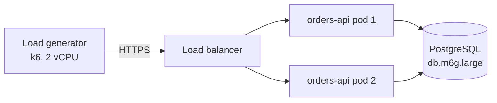

# <System>: performance test report, <release or date>

<!--
How to use this template (HTML comments are guidance; scripts/docs/confluence_publish.py drops them):
- Generate the numbers, never type them: scripts/docs/perf_report.py produces the results table, the SLO verdict and the
  time series; scripts/docs/chart.py renders the charts for Confluence. Paste the output into section 5.
- State the method, the environment and what was excluded. A report that cannot be reproduced is an opinion.
- Lead with the verdict. Reviewers read section 1 and the charts; everything else is evidence.
-->

| Field | Value |
|---|---|
| Status | Draft / Final |
| System under test | <service> <version> (commit <sha>) |
| Test date | YYYY-MM-DD, HH:MM to HH:MM UTC |
| Environment | staging (section 3) |
| Tool | JMeter 5.6 / k6 0.5x / Gatling 3.x |
| Owner | @name |
| Related | NFR spec <ID>, previous report <link>, ticket <KEY-123> |

[[TOC]]

## 1. Summary and verdict

<!-- Three to five sentences: did the system meet its targets under the agreed load, what is the single most important
finding, and what do you recommend (go, no-go, go with conditions). Then the SLO table. -->

| SLO | Target | Measured | Verdict |
|---|---|---|---|
| Latency p95, POST /api/v1/orders | ≤ 300 ms at 50 req/s | 352 ms | ❌ FAIL |
| Latency p99, all requests | ≤ 800 ms | 435 ms | ✅ PASS |
| Error rate | ≤ 1 % | 0.5 % | ✅ PASS |
| Throughput | ≥ 50 req/s sustained for 10 min | 50.1 req/s | ✅ PASS |

**Recommendation:** <go / no-go / go with conditions, in one sentence>.

## 2. Objectives and SLOs

- <question the test answers, e.g. "does release 1.4 sustain 50 req/s within the latency SLO?">
- SLO source: <link to the NFR spec or architecture document section 9>

## 3. Test environment

| Component | Spec and version | Notes |
|---|---|---|
| orders-api | 2 pods, 1 vCPU, 1 GiB, JDK 25, Spring Boot 4.1 | same image as production |
| PostgreSQL | db.m6g.large, PostgreSQL 16 | production is db.m6g.2xlarge |
| Load generator | k6 0.5x on 2 vCPU VM, same region | CPU below 60 % throughout |

*Figure 1: test topology. Differences from production are listed below; they bound what the results can claim.*

| Difference from production | Effect on the results |
|---|---|
| smaller database instance | latency is pessimistic for DB-bound requests |
| no CDN or WAF in front | network latency is optimistic by ~20 ms |

## 4. Workload model

| Scenario | Weight | Rate or users | Ramp | Think time | Data |
|---|---|---|---|---|---|
| POST /api/v1/orders | 50 % | 25 req/s | 2 min to full rate | none (arrival-rate model) | 10 000 synthetic customers, 200 SKUs |
| GET /api/v1/orders/{id} | 50 % | 25 req/s | 2 min | none | ids created during the run |

- Duration: <N> min at full rate; the first <M> min (warm-up) are excluded from the statistics.
- <assumptions, e.g. "the gateway's rate limit was disabled for the test">

## 5. Results

<!-- Section 5.1 and the time series come straight from:
     python3 scripts/docs/perf_report.py results.jtl --title "..." --slo "p95<=300,p99<=800,error_rate<=1" --bucket 60 \
         --series-csv images/p95.csv --out build/docs/results.md
     python3 scripts/docs/chart.py images/p95.csv --out images/p95.svg --title "p95 latency" --y-label ms \
         --threshold 300 --threshold-label "SLO 300 ms" --png -->

### 5.1 Results by scenario

| Scenario | Requests | Errors | Error % | Throughput (req/s) | Avg (ms) | p50 (ms) | p90 (ms) | p95 (ms) | p99 (ms) | Max (ms) | SLO |
|---|---|---|---|---|---|---|---|---|---|---|---|
| POST /api/v1/orders | 15 030 | 75 | 0.50 | 25.1 | 180 | 158 | 301 | 352 | 435 | 688 | ❌ FAIL (p95<=300) |
| GET /api/v1/orders/{id} | 15 010 | 0 | 0.00 | 25.0 | 57 | 55 | 79 | 91 | 118 | 154 | ✅ PASS |
| **All** | 30 040 | 75 | 0.25 | 50.1 | 119 | 88 | 238 | 301 | 433 | 688 | ❌ FAIL (p95<=300) |

### 5.2 Latency over time

*Figure 2: p95 latency per minute, all scenarios. The flat line is the 300 ms SLO; the breach is confined to minutes 6 to 7.*

<!-- In Git-rendered Markdown you can use the Mermaid xychart that perf_report.py emits instead of the PNG. -->

### 5.3 Throughput and errors over time

*Figure 3: throughput held at the target rate; errors cluster in the same two minutes as the latency spike.*

### 5.4 Resource utilisation

| Resource | Average | Peak | Saturation point | Notes |
|---|---|---|---|---|
| orders-api CPU | 45 % | 92 % (minute 6) | 1 vCPU per pod | GC pauses up to 400 ms at peak |
| orders-api heap | 410 MiB | 780 MiB | 1 GiB limit | |
| PostgreSQL connections | 18 | 20 | pool size 20 | pool exhausted in minute 6 |

## 6. Analysis

### Bottlenecks and root causes

<!-- Evidence first, hypothesis second. Link the dashboard or profile that supports each claim. -->

1. <finding>: <evidence> (link). Likely cause: <hypothesis>. Confidence: high / medium / low.

### Comparison with the previous run

| Metric | Baseline (<date>, <version>) | This run | Change |
|---|---|---|---|
| p95 POST /api/v1/orders | 290 ms | 352 ms | +21 % |

### Anomalies and excluded data

- <what was excluded and why, e.g. "the first 2 minutes (warm-up, JIT and cache fill)">

## 7. Recommendations and next steps

| # | Recommendation | Expected effect | Owner | Priority |
|---|---|---|---|---|
| 1 | raise the connection pool to 40 and re-test | removes the minute-6 queueing | @name | high |

## Appendix

### Raw data and reproduction

- Results: <path or link to the JTL / k6 output>
- Commands: `k6 run --out csv=results.csv load/orders.js` then the two scripts quoted in section 5
- Configuration: <link to the test plan and environment manifests>

### Method

Percentiles are nearest-rank over all samples of a scenario; throughput is requests divided by the scenario's
first-to-last sample span; errors are samples flagged unsuccessful by the tool. Charts use 60-second buckets.
