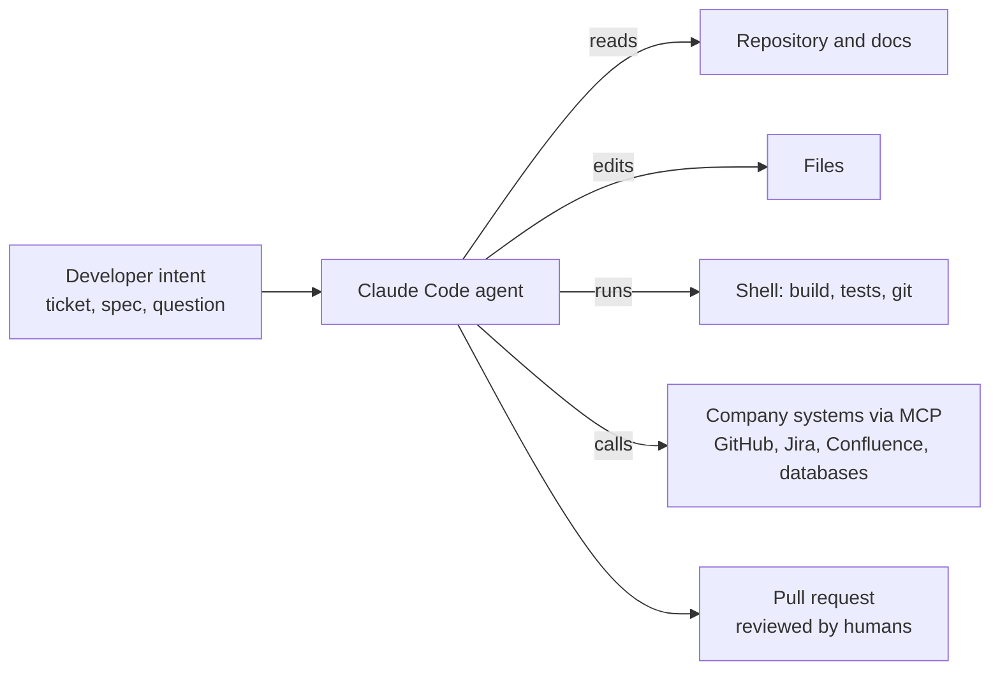
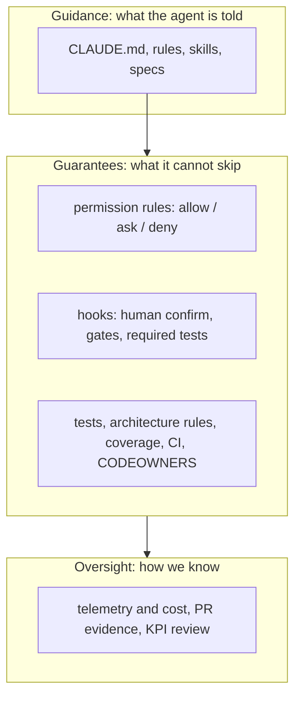
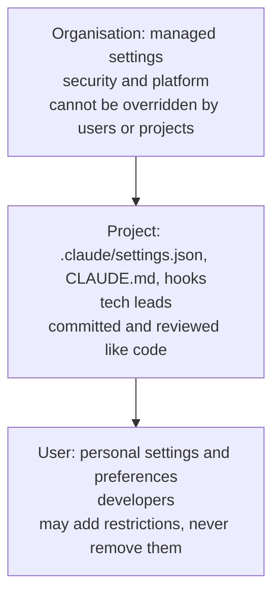
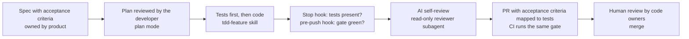

# Governing Claude Code at enterprise scale: executive briefing

*Format: 45 to 60 minutes. Each numbered section is one slide. Speaker notes are in italics.
Audience: CIO, CTO, CISO and their direct reports. Companion material: the
[training curriculum](README.md) and the reference implementation in this repository.*

## 1. The summary on one slide

- Claude Code is an AI agent for software work. It reads code, edits files, runs commands and calls company
  systems on a developer's behalf.
- Developers adopt AI coding agents with or without a policy. The real choice is between governed and
  ungoverned use.
- Governance has three layers: **guidance** (what the agent is told), **guarantees** (what it is technically
  required or prevented from doing) and **oversight** (how we see what it did and what it cost).
- Every control in this briefing exists in the product today and is demonstrated in this repository.
- We ask for five decisions (slide 14): deployment model, policy ownership, pilot scope, KPIs and baseline,
  enablement capacity.

*Speaker note: the message is neither "AI is dangerous" nor "AI is magic". It is "this is an engineering
system, and we govern it like one".*

## 2. What Claude Code is, in plain terms



- It runs in the terminal and the IDE, inside CI pipelines (GitHub Actions), in the browser (Claude Code on
  the web) and as a building block for custom agents (Agent SDK).
- It plans, acts, checks the result and iterates until the task is done or something blocks it.
- Unless constrained, it operates with the developer's own access. **Governance decides how much of that access
  it may use, and when a human must confirm.**

## 3. Why govern now

| Driver | What it means for us |
|---|---|
| Adoption is already happening | Unmanaged installs mean unknown data flows, personal API keys and no shared standards |
| Speed amplifies habits | An agent that writes code far faster also writes untested code, API drift and scope creep far faster, unless something stops it |
| The failure mode is the path of least resistance, not malice | When a test fails because code and API spec disagree, editing the spec is the shortest route to green. Controls must make the right path the easy path |
| Regulators and customers ask where code and data go | Deployment endpoint, data retention and audit trail are decisions, not defaults |
| The upside is real but must be measured | Faster delivery, consistent documentation and fewer review rounds are achievable. We baseline first and measure after |

## 4. The risk map, and the control for each risk

| Risk | Example | Primary control | Owner |
|---|---|---|---|
| Secrets and sensitive data in the agent's context | the agent reads `.env` or a private key | `deny` rules on secret paths, set centrally | security |
| Destructive actions | `rm -rf`, force push, hard reset, publishing artefacts | `deny` rules; `ask` for anything that changes shared state | platform |
| Unverified code reaching the repository | push without tests or with a red build | a pre-push hook that runs the same gate as CI; a Stop hook that requires tests | tech leads |
| API contract drift | the OpenAPI spec is edited to make a test pass | a human-confirm hook on contract files; contract tests; breaking-change check in CI; CODEOWNERS | API owners |
| Test weakening | assertions loosened, tests disabled | rules, a read-only reviewer subagent, CODEOWNERS on test infrastructure, a coverage gate | tech leads |
| Scope creep | "helpful" refactors outside the ticket | specs with an explicit out-of-scope list; the PR template's follow-ups section; the reviewer subagent | product, tech leads |
| Data leaving through integrations | an MCP server configured with production credentials | centrally approved MCP servers; read-only, scoped tokens; project servers reviewed in pull requests | security, platform |
| Prompt injection | instructions hidden in a web page, a dependency's README or an issue | permission prompts for new actions; read-only agents in CI; bypass mode disabled centrally; human review of every PR | security |
| Inconsistent practice | two hundred repositories, two hundred setups | one reviewed reference configuration, distributed as a plugin or template; CODEOWNERS on the configuration | platform |
| Cost without value | tokens spent, nothing merged | telemetry per team; cost dashboards; KPIs tied to merged outcomes | platform, finance |

*Speaker note: every row maps to a file in this repository or to an organisation-level setting. None of this
is aspirational.*

## 5. The governance principle

> **Guidance goes in markdown. Guarantees go in permissions, hooks, tests and CI.
> If breaking a rule would hurt, do not just write it down. Enforce it.**



*Speaker note: markdown instructions can be forgotten, misread or pushed out of the agent's working memory.
A hook runs every time. A test fails every time. That is the whole design philosophy.*

## 6. The policy stack: who controls what



| Layer | Set by | Typical content | How it is enforced |
|---|---|---|---|
| Organisation (managed settings) | CISO, platform | deny lists for secrets and destructive commands; bypass mode disabled; approved MCP servers and plugin sources; telemetry on; the approved API endpoint | deployed to devices by IT; takes precedence over everything else |
| Project (repository) | tech leads | build commands, non-negotiables, allow/ask lists, hooks, skills, subagents, CODEOWNERS | reviewed in pull requests; the guardrail files themselves are owned by tech leads |
| User | each developer | personal style, local tool paths | may tighten the layers above, never loosen them |

Details and exact file names: [module 02](modules/02-governance-framework.md) and
[module 04](modules/04-permissions-and-hooks.md).

## 7. Seven control families

| # | Family | What it governs | Module |
|---|---|---|---|
| 1 | Identity and deployment | who may use it, through which endpoint (Anthropic API, AWS Bedrock, Google Vertex AI, Microsoft Foundry, an LLM gateway), with what data retention | [08](modules/08-security-privacy-compliance.md) |
| 2 | Permissions | which tools and commands run freely, need confirmation, or are forbidden | [04](modules/04-permissions-and-hooks.md) |
| 3 | Hooks and gates | what must happen before or after an action: gate before push, tests before "done", human confirmation on contracts | [04](modules/04-permissions-and-hooks.md) |
| 4 | Context standards | how repositories tell the agent their rules without noise | [03](modules/03-context-and-memory.md) |
| 5 | Integrations (MCP) | which external systems it may reach, with which credentials | [06](modules/06-mcp-and-integrations.md) |
| 6 | SDLC quality gates | tests, contracts, PR evidence, CI, ownership | [07](modules/07-quality-gates-and-sdlc.md) |
| 7 | Observability and cost | telemetry, dashboards, KPIs, monthly pruning | [09](modules/09-observability-cost-roi.md) |

## 8. What good looks like: one feature, end to end



- The agent cannot declare "done" without tests, cannot push without a green gate, cannot touch the API
  contract without a human confirming, and cannot merge.
- Reviewers receive a consistent PR description with every acceptance criterion mapped to a unit test and an
  integration test.
- Everything that fired (blocked pushes, confirmations, review verdicts) is evidence.
- Worked example: feature ORD-002 in [`docs/11-playbook-java-developers.md`](../11-playbook-java-developers.md)
  and workflow card [WF-01](workflows/WF-01-spec-to-pull-request.md).

## 9. The reference implementation: this repository

| Control | File | Effort to reuse |
|---|---|---|
| Lean, always-loaded instructions | `CLAUDE.md` (under 50 lines) | keep the structure, rewrite the content |
| Path-scoped rules | `.claude/rules/*.md` | adapt to your stack |
| Permissions: allow / ask / deny | `.claude/settings.json` | adapt the commands |
| Hooks: contract confirm, pre-push gate, tests on stop | `.claude/hooks/*.sh` | copy as is |
| Workflows as skills | `.claude/skills/*` | copy, adjust names |
| Least-privilege subagents | `.claude/agents/*` | copy, adjust the review focus |
| One gate shared by hooks and CI | `scripts/verify.sh`, `.github/workflows/ci.yml` | swap the build command |
| Ownership of the guardrails | `.github/CODEOWNERS` | your teams |

The copy list with per-file guidance: [`docs/13-adopting-and-measuring.md`](../13-adopting-and-measuring.md).

## 10. Maturity model

| Level | Name | What is true | Typical gap |
|---|---|---|---|
| 0 | Ad hoc | individual installs, personal API keys, no policy | unknown data flows, no visibility |
| 1 | Managed | central identity and billing, one approved endpoint, managed settings with deny lists, telemetry on | repositories have no standards; quality varies by developer |
| 2 | Guarded | a reference configuration in every active repository: lean CLAUDE.md, allow/ask/deny, hooks, local gate equal to the CI gate, CODEOWNERS | practices still differ between teams |
| 3 | Standardised | shared skills, subagents and hooks distributed as a plugin from an internal marketplace; an approved MCP catalogue; Claude in CI as read-only reviewer | ROI asserted, not measured |
| 4 | Optimised | KPIs reviewed monthly; rules pruned; corrections become hooks or tests; automated audits for doc drift and missing tests | staying there |

*Most organisations start at level 0 or 1. The 90-day plan reaches level 2 for pilot teams and builds the
foundation for level 3.*

## 11. The 90-day plan

```mermaid
gantt
    dateFormat  YYYY-MM-DD
    axisFormat  %b
    section Days 0 to 30: foundation
    Decisions: deployment, owners, pilot scope       :a1, 2026-11-02, 10d
    Managed settings v0.1, telemetry switched on     :a2, after a1, 10d
    Reference config in 3 to 5 pilot repos, baseline :a3, after a1, 15d
    section Days 31 to 60: pilot
    Role-based training                              :b1, 2026-12-01, 15d
    Pilot teams deliver with WF-01, WF-02, WF-05     :b2, 2026-12-01, 30d
    Weekly office hours feed rules and hooks         :b3, 2026-12-08, 25d
    section Days 61 to 90: scale
    Internal plugin, MCP catalogue, policy v1.0      :c1, 2027-01-04, 20d
    KPI review and go or no-go for wave two          :c2, after c1, 7d
```

*Dates are illustrative. Start with commands and the gate: a reliable verification script is worth more than
any amount of markdown.*

## 12. KPIs: the scorecard

| Area | KPI | Source | Direction |
|---|---|---|---|
| Adoption | active users; sessions per developer per week | telemetry (OpenTelemetry) | up, then stable |
| Quality | first-pass CI green rate on agent-assisted PRs | CI | up |
| Quality | review rounds per PR | Git hosting | down |
| Quality | PRs with production changes but no test changes | gate script in CI | to zero |
| Safety | unplanned contract changes | contract check in CI | to zero |
| Safety | blocked pushes, permission denials, attempted reads of secret paths | hooks and telemetry | visible, trending down |
| Quality | escaped defects after merge | issue tracker | down |
| Velocity | lead time from spec Ready to merge | spec status and merge date | down |
| Cost | spend per active developer; tokens per merged PR | telemetry, usage analytics | within budget; per PR trending down |

Fill-in template: [`templates/kpi-scorecard.md`](templates/kpi-scorecard.md). Collect a baseline before the
pilot and design a fair comparison ([module 09](modules/09-observability-cost-roi.md)).

## 13. Roles and responsibilities

| Role | Responsible for |
|---|---|
| CIO (sponsor) | funding, priorities, the day-90 go or no-go |
| CISO and security | the organisation layer: deny lists, approved endpoints, MCP and plugin allowlists, data classification rules, incident process |
| Platform and developer enablement | managed settings rollout, the reference configuration and internal plugin, telemetry and dashboards, training delivery |
| Tech leads and architects | repository configuration, CODEOWNERS, contract ownership, monthly pruning of rules |
| Developers | use the workflows, read the diffs they ship, report every repeated correction |
| Product and business analysts | specs with testable acceptance criteria and an explicit out-of-scope list |
| Legal, compliance, procurement | commercial terms, data retention, residency, audit requirements |

## 14. Decisions requested today

1. **Deployment model.** Anthropic API through Claude for Enterprise, our cloud provider (Bedrock, Vertex AI or
   Foundry), or our LLM gateway. This drives identity, billing, data residency and retention.
2. **Policy ownership.** Security owns the organisation layer, platform operates it, tech leads own the
   repository layer.
3. **Pilot scope.** Three to five teams with a real backlog, mixed stacks and willing tech leads.
4. **KPIs and baseline.** Adopt the scorecard and collect four weeks of baseline before training starts.
5. **Enablement capacity.** A small platform team owns managed settings, the reference configuration,
   telemetry and training.

## 15. What we are not claiming

- Not a replacement for code review or ownership. Humans approve intent and risk; machines check what machines
  check better.
- Not zero risk. Controls reduce risk and make the residual visible and measurable.
- No productivity numbers until we have measured our own baseline. Vendor figures are not our figures.

## Appendix

- Vocabulary: [`glossary.md`](glossary.md)
- The curriculum and learning paths: [`README.md`](README.md)
- Workflow catalogue: [`workflows/README.md`](workflows/README.md)
- Templates: policy, readiness checklist, managed settings, KPI scorecard in [`templates/`](templates/)
- Official documentation: https://code.claude.com/docs
