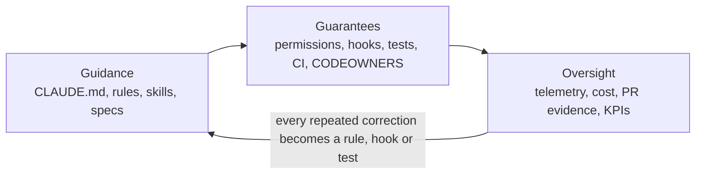

# Claude Code governance: enterprise training curriculum

Training material for adopting Claude Code across an enterprise with governance designed in from day one.
It serves four audiences: executives who sponsor and fund the rollout, platform and security teams who set
policy, tech leads and developers who work inside it every day, and product people who feed it precise
requirements.

This repository is the hands-on lab. Every control the curriculum teaches exists here as a file you can open,
run and copy: the lean [`CLAUDE.md`](../../CLAUDE.md), the permissions and hooks in
[`.claude/settings.json`](../../.claude/settings.json), the skills and subagents under [`.claude/`](../../.claude/),
the pre-PR gate [`scripts/verify.sh`](../../scripts/verify.sh) and a CI pipeline that runs the same scripts.
The 14 practitioner guides in [`docs/`](../README.md) are the reference text; this curriculum is the teaching
layer on top of them.

## The one idea the whole curriculum teaches

> **Guidance goes in markdown. Guarantees go in permissions, hooks, tests and CI. Oversight comes from
> telemetry and review.**

Claude Code is an agent: it reads files, edits them, runs commands and calls external systems on a developer's
behalf. Governing it is not about writing longer instructions. It is about deciding, per layer of the
organisation, what the agent *may* do (permissions), what *must* happen before it may proceed (hooks and gates),
what it *should* know (context) and how you *prove* what happened (telemetry, PR evidence, audit trail).



## Directory structure

```
docs/training/
├── README.md                          # this file: curriculum map, learning paths, delivery formats
├── 00-executive-briefing.md           # CIO / CTO / CISO briefing: risks, governance model, 90-day plan, KPIs, decisions
├── glossary.md                        # the vocabulary, written for non-practitioners
├── knowledge-checks.md                # short checks per module, with answers
├── modules/                           # ten teaching modules: objectives, topics, demo, controls, exercises
│   ├── 01-foundations.md              # what Claude Code is, how it works, where risk comes from
│   ├── 02-governance-framework.md     # policy stack, roles, guidance vs guarantees, minimum standard
│   ├── 03-context-and-memory.md       # CLAUDE.md hierarchy, path rules, nested memory, pruning
│   ├── 04-permissions-and-hooks.md    # allow / ask / deny, permission modes, hooks as deterministic controls
│   ├── 05-skills-subagents-plugins.md # standard workflows, least-privilege agents, distribution via plugins
│   ├── 06-mcp-and-integrations.md     # connecting to enterprise systems: scopes, allowlists, credentials
│   ├── 07-quality-gates-and-sdlc.md   # tests before the PR, contracts, PR evidence, CI, ownership
│   ├── 08-security-privacy-compliance.md  # deployment options, data handling, sandboxing, prompt injection, audit
│   ├── 09-observability-cost-roi.md   # telemetry, cost controls, KPIs, measuring the gain
│   └── 10-adoption-and-change-management.md  # rollout sequence, maturity model, champions, pruning
├── workflows/                         # workflow cards: steps, the feature used and the guardrail active at each step
│   ├── README.md                      # catalogue and feature × workflow matrix
│   ├── WF-01-spec-to-pull-request.md
│   ├── WF-02-safe-api-contract-change.md
│   ├── WF-03-bug-fix-reproduce-first.md
│   ├── WF-04-understanding-a-large-codebase.md
│   ├── WF-05-ai-assisted-code-review.md
│   ├── WF-06-architecture-docs-adrs-perf-reports.md
│   ├── WF-07-from-idea-to-testable-spec.md
│   ├── WF-08-onboarding-a-repository.md
│   ├── WF-09-enterprise-policy-rollout.md
│   └── WF-10-headless-and-scheduled-automation.md
└── templates/                         # copy-and-fill artefacts for the rollout
    ├── governance-policy-template.md  # an AI coding agent usage policy, section by section
    ├── repo-readiness-checklist.md    # what must be true before Claude Code is enabled on a repository
    ├── managed-settings.example.json  # an organisation-level settings file with the usual deny lists
    ├── kpi-scorecard.md               # baseline / target / current per KPI
    └── workflow-card-template.md      # write your own workflow cards in the same shape
```

## Module overview

| # | Module | Audience | Time | Governance question it answers |
|---|---|---|---|---|
| 01 | [Foundations](modules/01-foundations.md) | everyone | 45 min | What exactly are we governing? |
| 02 | [Governance framework](modules/02-governance-framework.md) | executives, platform, security, tech leads | 60 min | Who decides what, and how is it enforced? |
| 03 | [Context and memory](modules/03-context-and-memory.md) | tech leads, developers | 60 min | How does the agent learn our standards without drowning in them? |
| 04 | [Permissions and hooks](modules/04-permissions-and-hooks.md) | platform, tech leads, developers | 90 min | What may it do, and what must happen before it proceeds? |
| 05 | [Skills, subagents and plugins](modules/05-skills-subagents-plugins.md) | tech leads, developers, platform | 60 min | How do we make good practice the default in every repository? |
| 06 | [MCP and integrations](modules/06-mcp-and-integrations.md) | platform, security, tech leads | 60 min | How does data move in and out, and who approved it? |
| 07 | [Quality gates and the SDLC](modules/07-quality-gates-and-sdlc.md) | tech leads, developers, product | 90 min | How do we know the code is right before it merges? |
| 08 | [Security, privacy and compliance](modules/08-security-privacy-compliance.md) | security, platform, executives | 60 min | Where does our code go, and what can the agent touch? |
| 09 | [Observability, cost and ROI](modules/09-observability-cost-roi.md) | executives, platform, tech leads | 45 min | Is it working, what does it cost, and can we prove it? |
| 10 | [Adoption and change management](modules/10-adoption-and-change-management.md) | executives, platform, tech leads | 45 min | How do we roll out without two hundred different setups? |

## Learning paths by role

| Role | Path | Time |
|---|---|---|
| CIO, CTO, CISO and direct reports | [Executive briefing](00-executive-briefing.md), then module 02 (sections 1 to 3) and module 09 | 60 to 90 min |
| Platform engineering and security (policy owners) | 01 → 02 → 04 → 06 → 08 → 09 → 10; workflows WF-08, WF-09, WF-10; templates: policy, managed settings | 1 day |
| Tech leads and architects (repository owners) | 01 → 02 → 03 → 04 → 05 → 07 → 10; workflows WF-01, WF-02, WF-05, WF-06, WF-08 | 1 day plus lab |
| Developers | 01 → 03 → 04 → 05 → 07; workflows WF-01 to WF-05 hands-on in this repository | half-day lab |
| Product managers and business analysts | 01 → 07 (sections 1, 2 and 6) → WF-07 → [PM playbook](../12-playbook-project-managers.md) | 90 min |
| Compliance, legal, internal audit | 01 → 02 → 08 → 09; templates: policy and KPI scorecard | 2 hours |

## Delivery formats

| Format | Audience | Length | Material and outcome |
|---|---|---|---|
| Executive briefing | leadership | 45 to 60 min | `00-executive-briefing.md` presented slide by slide; ends with the five decisions |
| Policy workshop | platform and security | half day | modules 02, 04, 06, 08, 09; outcome: a first `managed-settings.json` and a policy draft from the templates |
| Tech-lead workshop | tech leads, architects | half day plus 2 h lab | modules 03, 04, 05, 07; lab: WF-08 on one of your real repositories |
| Developer lab | developers | 3 h | modules 01, 03, 04, 07 condensed; lab: WF-01 and WF-02 in this repository, triggering every hook on purpose |
| Product session | PMs, BAs | 90 min | module 07 (first half) and WF-07; outcome: one spec written with the `write-spec` skill |
| Office hours | all | weekly, 30 min | collect corrections and friction; turn each into a rule, hook or test (module 10) |

## Using this repository as the lab

Before class: JDK 25 (or let the Gradle toolchain download it), `jq`, Claude Code installed, and
`scripts/verify.sh` green on the trainer's machine. Each participant clones the repository and opens Claude Code
in its root so the memory hierarchy loads correctly.

Suggested exercises, in order:

1. **See the context**: `/memory`, `/context`, `/hooks`, `/permissions`, `/agents`. Note how little is loaded.
2. **WF-01**: "Implement a *mark order as shipped* endpoint with the tdd-feature skill. Stop after the plan."
3. **WF-02**: "Change the `OrderResponse` field `total` to `grandTotal`." Watch the `contract-change` skill
   classify it as breaking and route it to a v2 plus an ADR.
4. **Trigger every guardrail**: edit a contract file (the hook asks), finish a turn with a production change and
   no test (the Stop hook blocks), push with a failing test (the pre-PR gate blocks).
5. **WF-05**: run the `code-reviewer` subagent on a branch and read its verdict.
6. **WF-06**: "Use the tech-doc skill to write the architecture document for this service from the code. Show the
   outline first."

## Maintaining the material

- Each module ends with "further reading" into the guides. When a guide changes, update the module.
- Claude Code changes quickly. Before each delivery, check feature and setting names against the official
  documentation (https://code.claude.com/docs) and note the version taught on the title slide.
- After each delivery, add the questions you were asked to the module's "common questions" and to
  [`knowledge-checks.md`](knowledge-checks.md).
- Treat this folder like code: changes go through a pull request and are owned by developer enablement.
