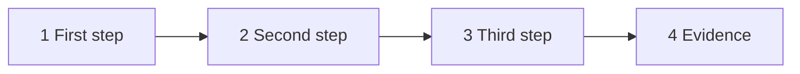

# WF-NN: [Workflow title]

| | |
|---|---|
| **Who** | [roles: who drives, who reviews, who owns the inputs] |
| **When** | [the trigger: a spec is Ready, a bug is reported, a PR is opened, …] |
| **Features** | [plan mode · skills · subagents · hooks · permissions · MCP · headless · plugins] |
| **Guides** | [links to the guides in `docs/` and to the files involved] |

## Flow

*Twelve nodes or fewer. Use the code's and the repository's own names.*

## Steps

| # | Step | Prompt or action | Feature | Guardrail active |
|---|---|---|---|---|
| 1 | | | | |
| 2 | | | | |
| 3 | | | | |

## Guardrails that fire, and what the user sees

- [the hook or rule, and the exact message or prompt the developer sees]

## Evidence produced

- [branch, commits, PR sections, CI logs, documents, verdicts]

## Prompts that work

| Situation | Prompt |
|---|---|
| | |

## Variations

- [other build tools, other contract types, CI or web surface]

## Anti-patterns

- [what people do that defeats the workflow, and the better alternative]

## Notes for tech leads

[Which human decision points remain. Which metric this workflow moves.]
