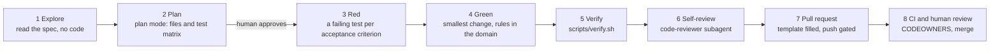

# WF-01: Spec to pull request

| | |
|---|---|
| **Who** | developer (driver), tech lead (reviewer), product (spec owner) |
| **When** | a spec in `docs/specs/` has status `Ready` |
| **Features** | plan mode · `tdd-feature` and `pr-ready` skills · path rules (`java.md`, `testing.md`) · Stop hook · pre-push gate hook · `code-reviewer` subagent · permissions · PR template · CODEOWNERS |
| **Guides** | [`docs/11`](../../11-playbook-java-developers.md), [`docs/09`](../../09-pr-workflow-and-ci.md), [`docs/08`](../../08-testing-strategy.md) |

## Flow

## Steps

| # | Step | Prompt or action | Feature | Guardrail active |
|---|---|---|---|---|
| 1 | Fresh session, explore | `/clear`, then *"Read `docs/specs/ORD-00X-….md` and the `Order` aggregate. Summarise the acceptance criteria and say whether the contract must change. No code yet."* | memory hierarchy: `CLAUDE.md` always, rules on demand | reads are allowed; nothing is edited |
| 2 | Plan | Shift+Tab into plan mode. *"Plan ORD-00X with the tdd-feature skill. Include the test matrix."* | plan mode, skill step 2 | plan mode is read-only; the human approves the plan |
| 3 | Red | Leave plan mode. The agent writes `acN_…` tests and runs `./gradlew test --tests <Class>` until they fail for the right reason | skill step 3, `testing.md` rule | the allow list runs Gradle without prompts |
| 4 | Green | The smallest change that passes; business rules in the aggregate; `./gradlew test` in the loop | `java.md` rule, `ArchitectureTest` | ArchUnit fails on a layer violation |
| 5 | Verify | `scripts/verify.sh` | the gate, quiet on success | coverage gate, contract tests, tests-present check |
| 6 | Self-review | `/pr-ready` | `pr-ready` skill runs `code-reviewer` | the reviewer has no Edit or Write tool |
| 7 | Pull request | The skill fills the template and asks before pushing; `git push` | Stop hook, pre-push hook, `ask` on push | no "done" without tests; no push with a red gate; a human confirms the push |
| 8 | CI and review | CI runs the same scripts plus oasdiff; code owners review; merge | CI, branch protection, CODEOWNERS | no self-merge; API owners for contract changes |

## Guardrails that fire, and what the developer sees

- **Stop hook**: *"Production code changed without any test changes … Write the missing tests before finishing."*
  The agent continues instead of stopping.
- **Pre-push gate**: *"Blocked: pre-PR gate failed. Fix the problems below … Don't skip, disable or weaken tests."*
  followed by the filtered failures only.
- **Contract edit**: *"CONTRACT CHANGE: … approve only if intended and the contract-change skill was followed."*
  At this point [WF-02](WF-02-safe-api-contract-change.md) takes over.

## Evidence produced

- A branch `ORD-00X-<title>` with small commits `ORD-00X: <imperative summary>`.
- A PR description with the acceptance-criteria-to-tests table, contract impact, verification checklist, docs
  checklist and follow-ups.
- A CI run showing the tests-present check, the contract check, the build and the coverage report artefact.
- The spec's traceability table updated with test names.

## Prompts that work

| Situation | Prompt |
|---|---|
| Start | "Implement ORD-123 using tdd-feature. Stop after the plan." |
| The plan is too big | "Split the plan: contract change first as its own PR, then the domain rule, then the endpoint." |
| Long session | "/compact keep the AC list, the test matrix and the currently failing test" |
| Finish | "/pr-ready" |

## Variations

- **Maven**: replace `./gradlew check` with `mvn -B verify` in `verify.sh`, `CLAUDE.md` and the allow list.
- **Multi-module builds**: give the agent the per-module fast loop (`./gradlew :module:test`).
- **Parallel test writing**: "use three test-writer agents, one per acceptance criterion".
- **Claude Code on the web or CI**: the same files apply; the push still goes through the gate hook.

## Anti-patterns

- Skipping plan mode for anything non-trivial. The plan is the cheapest point to correct course.
- Running the full gate after every edit. Use the fast loop; the gate runs at push.
- Approving the push prompt without reading the diff. The gate proves it works; your review proves it is right.

## Notes for tech leads

The human decision points in this workflow are exactly four: plan approval, contract confirmation, push
confirmation, PR review. Everything else is automatic and leaves evidence.
