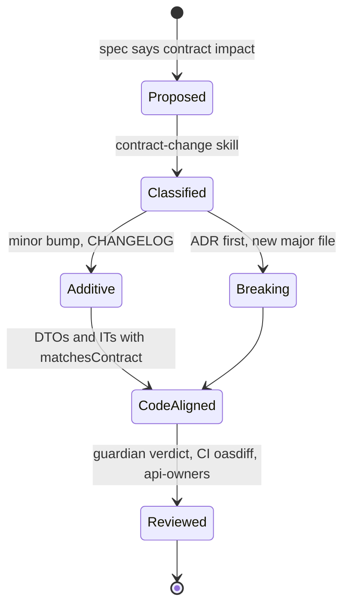

# WF-02: Safe API contract change

| | |
|---|---|
| **Who** | developer, API owner (CODEOWNERS), tech lead for breaking changes |
| **When** | a spec declares contract impact, or a task needs a new or changed endpoint or field |
| **Features** | nested `contracts/CLAUDE.md` · `contract-change` skill with `compatibility-rules.md` · `protect-contracts` hook (`ask`) · `contract-guardian` subagent · `write-adr` skill · `check-contract-change.sh` in the gate and CI · oasdiff job · CODEOWNERS |
| **Guides** | [`docs/07`](../../07-contracts.md), [`contracts/CHANGELOG.md`](../../../contracts/CHANGELOG.md), [ADR-0003](../../adr/0003-order-cancellation.md) |

## Flow

## Steps

| # | Step | Prompt or action | Feature | Guardrail active |
|---|---|---|---|---|
| 1 | Confirm the change is wanted | *"Implement ORD-00X. It has contract impact. Use the contract-change skill first and stop after classification."* | skill step 1 | if the only reason is "the test disagrees with the contract", the skill stops: fix the code instead |
| 2 | Classify | The skill reads `compatibility-rules.md` and states additive or breaking | reference file loads on demand | when unsure, the skill treats it as breaking and asks |
| 3a | Additive | Edit the v1 file, bump `info.version` minor, add a CHANGELOG entry | `protect-contracts` hook | the human confirms the edit; the reason text names the skill steps |
| 3b | Breaking | `write-adr` first (why, alternatives, migration, sunset), copy to a new `v2` file, CHANGELOG marked breaking, plan the parallel `/api/v2` | `write-adr` skill, nested memory | v1 untouched; v1 tests keep passing |
| 4 | Make code follow the contract | DTOs match field for field; every new response code has an `*IT` with `matchesContract()` | `testing.md` rule | the contract test fails if code and spec disagree in either direction |
| 5 | Verify | `scripts/check-contract-change.sh`, then `scripts/verify.sh` | gate scripts | version bump, changelog and ADR presence are checked mechanically |
| 6 | Guardian review | *"Use the contract-guardian agent to review the contract diff on this branch."* | read-only subagent | verdict: safe, needs changes, needs human decision |
| 7 | Pull request | Fill the Contract impact section; push | pre-push gate, `ask` on push | CI repeats the checks and runs `oasdiff breaking`; api-owners must approve |

## Guardrails that fire

- **The hook** turns every edit under `contracts/openapi/` into a question with the reason text shown to both
  the human and the agent.
- **The contract test** fails the build when a field is added in code without the contract
  (`additionalProperties: false`) or removed from the contract while still produced.
- **`check-contract-change.sh`** fails when a contract edit has no version bump, no CHANGELOG entry or, for a
  major version, no ADR.
- **oasdiff** in CI fails on a breaking change inside an existing version file.
- **CODEOWNERS** requires the API owners' approval for anything under `contracts/`.

## Evidence produced

- `contracts/CHANGELOG.md` entry classified additive or breaking, linking the spec and ADR.
- For breaking changes: an ADR with alternatives, migration note and sunset date; a new major-version file.
- The guardian's structured verdict in the PR, and the Contract impact section filled.
- CI logs for the contract check and the compatibility job.

## The negative path, worth demonstrating

*"`OrdersApiContractIT` fails on `total`. Fix the code to match the contract. Don't touch `contracts/`."*
The agent fixes the DTO. If it tries to edit the contract instead, the hook asks and the human declines.

## Variations

The same pattern (folder, nested memory, ask-hook, verification test, CI diff tool, CODEOWNERS) applies to
Kafka/Avro with Schema Registry compatibility, protobuf with `buf breaking`, database schemas with migration
lint, Java library APIs with `japicmp` or `revapi`, and consumer-driven contracts with Pact. See the table in
[`docs/07`](../../07-contracts.md).

## Anti-patterns

- Approving the hook's question reflexively. Read the reason text; it names what should already have happened.
- Changing a contract and the code in one unreviewed commit with the changelog "to follow".
- Treating a new enum value as additive without knowing how consumers handle unknown values.
