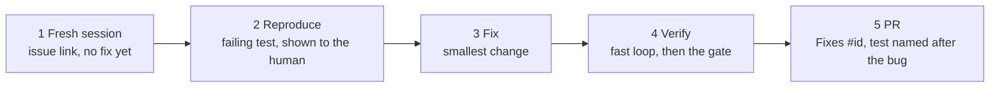

# WF-03: Bug fix, reproduce first

| | |
|---|---|
| **Who** | developer |
| **When** | a bug report with a reproduction, or a failing production scenario |
| **Features** | failing test first · `testing.md` rule · Stop hook · pre-push gate · permissions · `/clear` |
| **Guides** | [`docs/11`](../../11-playbook-java-developers.md), [`docs/08`](../../08-testing-strategy.md) |

## Flow

## Steps

| # | Step | Prompt or action | Feature | Guardrail active |
|---|---|---|---|---|
| 1 | Fresh session | `/clear`, then *"Read issue #456 (or the description below). Do not fix anything yet."* | context hygiene | only reads |
| 2 | Reproduce | *"Write a failing test that reproduces #456 first. Show me the failure message."* | `testing.md` rule (fixed Clock, fakes, behaviour not implementation) | a test that passes immediately is rejected: it does not reproduce the bug |
| 3 | Fix | *"Now make it pass with the smallest change. Do not touch other tests."* | `java.md` rule, `ArchitectureTest` | the rule forbids weakening or disabling existing tests |
| 4 | Verify | `./gradlew test --tests <Class>`, then `scripts/verify.sh` | the gate | coverage and contract tests still pass |
| 5 | PR | Commit `ORD-456: fix …`; `/pr-ready`; push | Stop hook, pre-push gate, PR template | tests present; gate green; a human confirms the push |

## Guardrails that fire

- The Stop hook blocks a "done" that changed `src/main` without touching tests.
- The pre-push gate blocks a push while any test is red.
- The reviewer subagent flags a fix that changed an existing assertion instead of the code.

## Evidence produced

- A test whose name reads as the bug (`cancelOrder_blankReason_returns400Problem`), present in the PR before the fix commit.
- A PR that references the issue and shows the failing-then-passing test in the description.

## Decision point

If the "bug" is really a disagreement between code and contract, stop. Decide with the API owner whether the
code or the contract is wrong, then follow [WF-02](WF-02-safe-api-contract-change.md) if the contract must change.

## Anti-patterns

- Fixing first and adding a test that mirrors the fix afterwards.
- Loosening an assertion because "the old test was too strict".
- Fixing three unrelated things found along the way. Note them as follow-ups in the PR instead.
