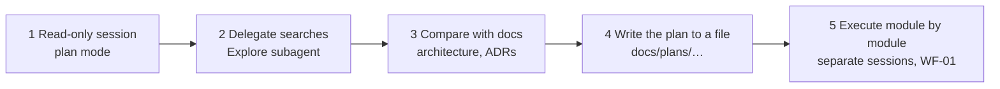

# WF-04: Understanding a large or legacy codebase

| | |
|---|---|
| **Who** | developer joining a team, architect assessing a system, anyone planning a cross-cutting change |
| **When** | before changing code you do not know; before a migration or a repo-wide refactor |
| **Features** | Explore subagent · plan mode · `/context` and `/compact` · nested `CLAUDE.md` per module · `/add-dir` · plans written to files · read-only permissions |
| **Guides** | [`docs/04`](../../04-subagents.md), [`docs/11`](../../11-playbook-java-developers.md) (large-codebase tips), [`docs/01`](../../01-context-engineering.md) |

## Flow

## Steps

| # | Step | Prompt or action | Feature | Guardrail active |
|---|---|---|---|---|
| 1 | Start read-only | Shift+Tab into plan mode. *"I need to understand how orders move from PLACED to SHIPPED. Do not edit anything."* | plan mode | no edits possible |
| 2 | Delegate the searching | *"Use an explore agent to find every place that constructs `OrderResponse`. Report file:line only."* | Explore subagent | the search happens in the subagent's context; only the result returns |
| 3 | Check the docs against the code | *"Compare `docs/architecture/overview.md` with the code and list discrepancies."* | linked docs, Mermaid diagrams | `docs.md` rule: diagrams updated in the same PR as the code |
| 4 | Watch the budget | `/context`; when it fills, `/compact keep the list of call sites and the open questions` | context tools | one task per session |
| 5 | Persist | *"Write the migration plan to `docs/plans/ORD-200-postgres-migration.md`: modules in order, risks, tests."* | durable memory in files, not chat | the plan is reviewed in a PR |
| 6 | Execute | One module per session, each via [WF-01](WF-01-spec-to-pull-request.md); `/add-dir` for a sibling repository | `/clear`, nested `CLAUDE.md` per module | each module's rules load only when working there |

## Repository setup that makes this work

- A short `CLAUDE.md` per module that matters: purpose, owner, module-specific commands (`./gradlew :orders-core:test`).
- `.claude/rules/` scoped with `paths:` per module or technology, so a controller fix never pays for the Kafka rules.
- A nested `CLAUDE.md` in legacy areas: "bug fixes only, no refactors, do not change public signatures".
- Fast, cacheable builds (build cache, configuration cache, parallel execution) because the agent runs the build
  far more often than a human.

## Guardrails that fire

- Plan mode and read-only subagents make the exploration incapable of changing code.
- The `docs.md` rule and the PR template checkbox keep diagrams and code in step when the plan is executed.

## Evidence produced

- A plan file under `docs/plans/` reviewed in a PR; an ADR if the exploration led to a decision.
- A discrepancy list between documentation and code, which becomes documentation PRs.

## Anti-patterns

- Letting the main session grep through two hundred files. Delegate; keep the main context for decisions.
- One week-long session. Short sessions with specs, plans and ADRs as the durable memory.
- Pasting whole files into the chat. Point at them.
