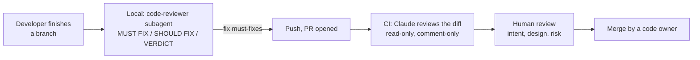

# WF-05: AI-assisted code review, locally and in CI

| | |
|---|---|
| **Who** | developers (local self-review), tech leads (review policy), platform (CI integration) |
| **When** | before every PR (local); on every PR (CI) |
| **Features** | `code-reviewer` and `contract-guardian` subagents · `pr-ready` skill · Claude Code GitHub Action · headless mode (`claude -p`) · read-only permissions · CODEOWNERS |
| **Guides** | [`docs/04`](../../04-subagents.md), [`docs/09`](../../09-pr-workflow-and-ci.md) |

## Flow

## Steps

| # | Step | Prompt or action | Feature | Guardrail active |
|---|---|---|---|---|
| 1 | Local self-review | *"Use the code-reviewer agent on this branch."* or `/pr-ready` | subagent with Read, Grep, Glob, Bash only | it cannot edit what it reviews |
| 2 | Contract review | *"Use the contract-guardian agent to review the contract diff."* when `contracts/` changed | read-only subagent | structured verdict; no edits |
| 3 | Address findings | Fix every MUST FIX; answer QUESTIONS in the PR description | main session | Stop hook and gate as in WF-01 |
| 4 | CI review | The GitHub Action (`anthropics/claude-code-action`) runs on the PR, or responds to `@claude` in comments, using the same `CLAUDE.md`, rules and agents | Claude in CI | the job has read access to code and write access to PR comments only |
| 5 | Headless variant | A CI step runs `claude -p "Use the contract-guardian agent on this PR's diff and output the verdict" --output-format json` and posts the result as a comment | headless mode | tool allowlist restricts it to reading and git diff |
| 6 | Human review | Code owners read the AI verdicts as *claims to verify*, then review intent, design and risk | CODEOWNERS, branch protection | the bot never approves or merges |

## Guardrails that fire

- Subagent tool lists make review read-only by construction.
- In CI, the workflow's token permissions (`contents: read`, `pull-requests: write`) bound what the action can do.
- Branch protection requires a human approval; the bot's comment is not an approval.

## Evidence produced

- The reviewer's verdict, in a fixed format, attached to the PR.
- The guardian's verdict for contract changes.
- A CI job log showing what the review examined.

## Governance rules for Claude in CI

1. **Read-only or comment-only.** Grant push rights only after you have reviewed exactly what it may push and why.
2. **Separate identity.** A dedicated bot account or app with its own token, scoped to the repository.
3. **Pin the action version** and review upgrades like any dependency.
4. **Same configuration as local.** The action reads the repository's `CLAUDE.md`, rules and agents, so review
   standards are identical on a laptop and in CI.
5. **Treat content as untrusted.** PR descriptions, issue comments and CI logs can carry injected instructions.
   A read-only reviewer limits the damage; humans decide on anything that looks like a redirection.
6. **Findings are claims.** A reviewer's "must fix" is verified by a human before it changes a decision.

## Anti-patterns

- Giving the CI agent write access to the branch "so it can fix the nits". That turns a reviewer into an author
  with no reviewer.
- Letting the bot's green comment substitute for a human approval.
- Free-form review essays. The fixed output format keeps the signal and drops the noise.
