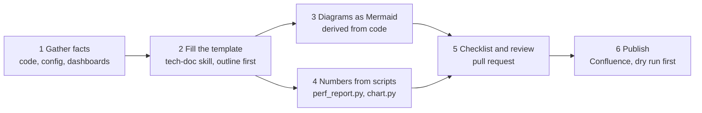

# WF-06: Architecture documents, ADRs and performance reports

| | |
|---|---|
| **Who** | architects, tech leads, anyone writing design documents or test reports |
| **When** | a new system or feature needs a design document; a decision is made; a load test produced results; docs must land on Confluence |
| **Features** | `tech-doc`, `write-adr`, `update-diagrams`, `perf-report` and `confluence-publish` skills · `docs.md` rule · Mermaid diagrams · generated numbers · Atlassian MCP or REST script |
| **Guides** | [`docs/10`](../../10-documentation-and-diagrams.md), [`docs/14`](../../14-technical-documentation.md) |

## Flow

## Steps

| # | Step | Prompt or action | Feature | Guardrail active |
|---|---|---|---|---|
| 1 | Outline | *"Use the tech-doc skill: write the architecture document for orders-service from the code. Audience: new engineers and on-call. Show me the outline before filling it."* | `tech-doc` skill, template | facts come from code; the human approves the outline |
| 2 | Diagrams | The skill produces context, container, data-flow, sequence and state diagrams as Mermaid | diagram cookbook | `docs.md` rule: Mermaid only, twelve nodes or fewer, derived from code |
| 3 | Decisions | *"Write an ADR for moving from the in-memory repository to Postgres. Give two alternatives."* | `write-adr` skill | ADRs are append-only; numbering and status rules |
| 4 | Keep diagrams true | After a code change: *"Use the update-diagrams skill: the cancel flow changed."* | `update-diagrams` skill | PR template checkbox; same PR as the code |
| 5 | Performance report | `python3 scripts/docs/perf_report.py results.jtl --slo "p95<=300,error_rate<=1"` via the `perf-report` skill | generated tables and charts | numbers are generated, never typed; method printed under the table |
| 6 | Publish | *"Publish `docs/architecture/orders-service.md` to Confluence space ARCH under page 123456. Dry run first."* | `confluence-publish` skill, Atlassian MCP or `confluence_publish.py` | dry run first; API token from an environment variable, never a file |

## Guardrails that fire

- The `docs.md` rule loads for any markdown edit: diagrams as Mermaid, charts from scripts, specs owned by product.
- CODEOWNERS on `docs/adr/` requires a tech lead's review of decisions.
- The quality checklist in the `tech-doc` skill must pass before the PR.

## Evidence produced

- A design document in Git, reviewed in a PR next to the code it describes; Confluence as a published view.
- ADRs with alternatives and consequences, immutable once accepted.
- A performance report whose numbers can be regenerated from the committed data file.

## Governance notes

- Markdown and Mermaid in Git are the source of truth. Confluence pages are generated, not edited by hand.
- A periodic headless job can run *"Compare `docs/architecture/overview.md` to the code and list
  discrepancies"* and open an issue with the result (see [WF-10](WF-10-headless-and-scheduled-automation.md)).

## Anti-patterns

- Typing numbers into a report. If it is not generated from data, it cannot be checked.
- Binary diagrams for architecture. They do not diff and the agent cannot update them.
- Publishing without a dry run.
