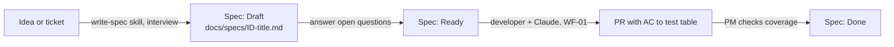

# WF-07: From idea to testable spec

| | |
|---|---|
| **Who** | product managers, business analysts, with the tech lead for contract impact |
| **When** | new functionality is requested and not yet specified |
| **Features** | `write-spec` skill with the spec template · an issue-tracker MCP server (Jira, Linear) in read-only mode · `docs.md` rule (specs owned by product) · the PR template's AC table |
| **Guides** | [`docs/12`](../../12-playbook-project-managers.md), [`.claude/skills/write-spec/`](../../../.claude/skills/write-spec/SKILL.md), [spec ORD-002](../../specs/ORD-002-cancel-order.md) |

## Flow

## Steps

| # | Step | Prompt or action | Feature | Guardrail active |
|---|---|---|---|---|
| 1 | Start from the idea | *"Use the write-spec skill. The idea: customers can cancel orders that haven't shipped; support needs the reason. Interview me about gaps before writing."* | skill step 2: interview | the skill must not invent business rules |
| 2 | Pull facts from the tracker | *"Read ticket ORD-3 from Jira and list its acceptance criteria."* | MCP server, read-only token | project-scoped server approved in a PR; no write access |
| 3 | Write testable criteria | Given / When / Then, numbered AC1…ACn; "fast" becomes "p95 < 200 ms at 50 req/s" | spec template | each AC must be verifiable by a test |
| 4 | Scope and impact | Fill Out of scope explicitly; fill Contract impact with the tech lead | template sections | out-of-scope is the main defence against scope creep |
| 5 | Status | `Draft` → `Ready` once open questions are answered | spec status field | the `tdd-feature` skill implements only `Ready` specs |
| 6 | Review the PR | Read the AC-to-tests table and the test names; check Contract impact and Follow-ups | PR template | every AC needs a unit test and an integration test |

## Guardrails that fire

- The `docs.md` rule: specs are owned by product; acceptance criteria are not changed without a human asking.
- The `tdd-feature` skill refuses specs that are not `Ready`.
- The MCP server runs with a read-only token scoped to one project.

## Evidence produced

- `docs/specs/<ID>-<title>.md` with numbered criteria, out-of-scope, contract impact, open questions and a
  traceability table that the developer fills with test names.
- A PR whose description maps every criterion to tests.

## Other product prompts that need no code

- "Which specs in `docs/specs` are Ready but have no merged implementation?"
- "Summarise what changed in the Orders API over the last three releases from `contracts/CHANGELOG.md`."
- "Draft release notes for users from the merged PRs since tag v1.2.0."
- "Compare spec ORD-002 to the tests. Is any acceptance criterion not covered?"

## Anti-patterns

- Criteria like "users can cancel orders". Which state? Which response? What is stored?
- Leaving Out of scope empty. The agent will fill the gap with its own ideas.
- Setting `Ready` with open questions. Ambiguity becomes confident, wrong code.
