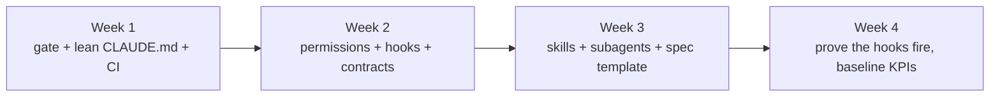

# WF-08: Onboarding a repository to governed Claude Code

| | |
|---|---|
| **Who** | tech lead (owner), platform engineer (support), the team |
| **When** | before Claude Code is used for real work on a repository |
| **Features** | `/init` · `CLAUDE.md` and `.claude/rules/` · `.claude/settings.json` · hooks · `scripts/verify.sh` · CI · CODEOWNERS · PR template · skills and subagents (or the enterprise plugin) |
| **Guides** | [`docs/13`](../../13-adopting-and-measuring.md), [`docs/02`](../../02-claude-md-and-rules.md), [readiness checklist](../templates/repo-readiness-checklist.md) |

## Flow

## Steps

| # | Step | Action | Feature | Done when |
|---|---|---|---|---|
| 1 | The gate | Write `scripts/verify.sh` for your build (Gradle, Maven, npm, …): quiet on success, failures only on error, under a few minutes | scripts | runs green locally and in CI |
| 2 | Lean memory | `/init`, then cut by half: delete generic content, move area rules into `.claude/rules/*.md` with `paths:`; add the five parts | `CLAUDE.md`, rules | under about 50 lines; `/memory` shows it |
| 3 | Permissions | Copy `.claude/settings.json`; adapt the allow list to your build and read-only git; keep `ask` on push, build config, CI, hooks and settings; keep the `deny` list for secrets and destructive commands | settings | `/permissions` shows the three lists |
| 4 | Hooks | Copy the three hooks as they are; point `pre-pr-gate.sh` at your `verify.sh`; adjust the paths in `check-tests-present.sh` | hooks | `/hooks` lists them; a deliberate violation is blocked |
| 5 | CI | CI runs the same scripts (`check-tests-present.sh`, `check-contract-change.sh`, the build); add a compatibility job if you have contracts | CI | local gate and CI cannot disagree |
| 6 | Ownership | CODEOWNERS for `contracts/`, `.claude/settings.json`, `.claude/hooks/`, `scripts/`, `docs/adr/`, `docs/specs/`; branch protection on `main` | CODEOWNERS | a change to a hook requires a tech lead's review |
| 7 | Workflows | Install the enterprise plugin, or copy `tdd-feature`, `pr-ready`, `write-spec`, `write-adr`, `code-reviewer`, `test-writer`; adapt names and commands | skills, subagents | `/agents` and skill list show them |
| 8 | Contracts | If other teams depend on an API, create `contracts/` with a nested `CLAUDE.md`, a contract test and CODEOWNERS | contracts | the pattern from WF-02 works end to end |
| 9 | PR template | Copy `.github/pull_request_template.md` | template | the next PR has the AC table |
| 10 | Prove it | Run the lab: edit a contract (ask), stop without tests (blocked), push red (blocked), `/pr-ready` | all | each guardrail fired once in front of the team |
| 11 | Baseline | Record four weeks of the KPIs in the [scorecard](../templates/kpi-scorecard.md) | metrics | baseline column filled |

## What to copy, adapt or write

| Copy as is | Adapt | Write for this repository |
|---|---|---|
| `.claude/hooks/*`, `scripts/changed-files.sh`, `check-tests-present.sh`, `check-contract-change.sh`, PR template, ADR and spec templates | `scripts/verify.sh`, `.claude/settings.json`, `.claude/agents/*`, `.github/CODEOWNERS`, CI workflow, coverage thresholds | `CLAUDE.md`, `.claude/rules/*.md`, `contracts/*`, architecture doc, ADRs, specs |

## Guardrails that fire during onboarding

- Edits to `.claude/settings.json` and `.claude/hooks/**` are themselves under `ask` and owned in CODEOWNERS, so
  the guardrails are protected from the start.

## Evidence produced

- The readiness checklist, complete and committed with the configuration PR.
- A lab transcript or short note showing each guardrail firing.
- The baseline row of the scorecard.

## Anti-patterns

- Starting with a 400-line `CLAUDE.md`. Start with commands and the gate; add guidance only after observed mistakes.
- A gate that takes twenty minutes. Developers and agents will route around it.
- Copying the Java rules into a TypeScript repository. The structure transfers; the content does not.
