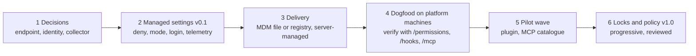

# WF-09: Enterprise policy rollout

| | |
|---|---|
| **Who** | platform engineering (driver), security (policy owner), IT device management (delivery) |
| **When** | before the pilot; repeated at each policy version |
| **Features** | managed settings · deny lists and mode pins · login and provider enforcement · telemetry `env` · MCP allowlists · plugin marketplaces · managed `CLAUDE.md` · version floors |
| **Guides** | [module 02](../modules/02-governance-framework.md), [module 04](../modules/04-permissions-and-hooks.md), [module 06](../modules/06-mcp-and-integrations.md), [module 09](../modules/09-observability-cost-roi.md); example file [`templates/managed-settings.example.json`](../templates/managed-settings.example.json) |

> **Version note.** Keys were checked against the official documentation in October 2026; several are
> version-gated (`allowedProviders` v2.1.285+, `managedMcpServers` v2.1.259+, hook `onFailure` v2.1.295+).

## Flow

## Steps

| # | Step | Action | Setting or artefact | Check |
|---|---|---|---|---|
| 1 | Decide | deployment endpoint, sign-in method, telemetry collector, default mode | decisions recorded in the policy (section 3) | signed off by security and the CIO |
| 2 | Author v0.1 | start from the example: deny list for secrets and destructive commands, `permissions.defaultMode`, `disableBypassPermissionsMode`, `forceLoginMethod` and `forceLoginOrgUUID`, telemetry `env` | `managed-settings.json` in a Git repository owned by platform, reviewed by security | JSON valid; every key explained in the table below |
| 3 | Choose delivery | device file through MDM or configuration management; registry or plist where available; server-managed settings for claude.ai sign-ins. Set `managedSourcesBehavior: "merge"` if you use more than one source | MDM profile, `managed-settings.d/` drop-ins | one machine of each OS verified |
| 4 | Dogfood | install on the platform team's own machines first; run `/permissions`, `/hooks`, `/mcp`; confirm telemetry arrives at the collector; try to select bypass mode | dashboards show sessions | a week without blocking surprises |
| 5 | Add the shared layer | publish the internal plugin (skills, agents, hooks); register the marketplace with `extraKnownMarketplaces`; force-enable it with `enabledPlugins`; publish the MCP catalogue and `allowedMcpServers`; a managed `CLAUDE.md` of at most ten lines | plugin v1.0.0, catalogue page | pilot repositories pass the readiness checklist |
| 6 | Pilot wave | three to five teams; weekly office hours; corrections become plugin releases | plugin changelog | KPIs collected (module 09) |
| 7 | Progressive locks | when the plugin covers what teams need: `allowManagedMcpServersOnly`, then `strictKnownMarketplaces` and `blockedMarketplaces`, then consider `allowManagedPermissionRulesOnly`; keep `allowManagedHooksOnly` off unless the managed layer carries all hooks | managed settings v1.0 | no increase in bypass attempts or shadow installs |
| 8 | Version floors and review | `minimumVersion` or `requiredMinimumVersion`; six-monthly review; re-check key names after releases | policy v1.0 | review minutes |

## The example file, key by key

| Key | Purpose | Module |
|---|---|---|
| `permissions.defaultMode: "default"` | start sessions in Manual; recent versions otherwise start in `auto` | 04 |
| `permissions.disableBypassPermissionsMode: "disable"` | bypass mode cannot be selected | 04 |
| `permissions.deny` | secrets and destructive commands denied in every mode; lower scopes can add rules, not remove these | 04 |
| `forceLoginMethod`, `forceLoginOrgUUID` | only the organisation's claude.ai sign-in works for terminal, VS Code and SDK sessions; set in every managed source | 08 |
| `env` with `CLAUDE_CODE_ENABLE_TELEMETRY` and `OTEL_*` | fleet telemetry to one collector; project files cannot override | 09 |
| `sandbox.enabled`, `sandbox.network.allowedDomains` | OS-level isolation of shell commands with a network allowlist; add `failIfUnavailable` and `allowManagedDomainsOnly` when enforcing | 08 |
| `allowedMcpServers` | approved servers matched by URL; add `allowManagedMcpServersOnly: true` once the catalogue is complete | 06 |
| `extraKnownMarketplaces`, `enabledPlugins` | the internal marketplace and the force-enabled governance plugin | 05 |

Not in the example and worth considering: `allowedProviders`, `availableModels` and `deniedModels`,
`maxEffortLevel`, `modelPricing`, `managedMcpServers`, `claudeMd`, `cleanupPeriodDays`, a managed `ConfigChange`
hook for audit.

## Gotchas

- Managed settings are a client-side control. A local administrator can edit the files. Keep branch protection,
  CI gates, network policy and server-side credentials as the backstop.
- Only one managed source applies by default. Mixing sources without `managedSourcesBehavior: "merge"` can
  silently drop policy.
- Sessions on third-party providers, gateway sign-ins and Cowork do not receive server-managed settings. Use
  device delivery for them.
- `serverName` in MCP allowlists is a label, not a security control. Match on URL or command.
- Bash deny patterns match command text, not intent. Use the sandbox allowlist for network enforcement.
- An empty `strictKnownMarketplaces` list blocks every marketplace, including the official one.

## Evidence produced

- The managed settings file under version control with review history.
- Dashboards showing sessions, denials and spend per team.
- Policy v1.0 with its control mapping (template appendix A).

## Anti-patterns

- Turning every lock on at once. Teams route around a tool that removes what they need.
- Shipping deny lists without the plugin. Developers get the constraints and none of the help.
- Treating the deployment as finished. Key names change between releases; re-verify at each review.
