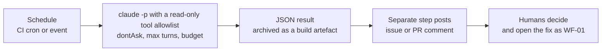

# WF-10: Headless and scheduled automation

| | |
|---|---|
| **Who** | platform engineers, tech leads |
| **When** | recurring read-only jobs: documentation drift audits, missing-test reports, release-note drafts, contract reviews on PRs |
| **Features** | headless mode (`claude -p`) · `--output-format json` · `--allowedTools` · `--max-turns` · `--max-budget-usd` · `dontAsk` permission mode · CI schedules · the GitHub Action · hooks still apply |
| **Guides** | [`docs/06`](../../06-mcp-and-tools.md), [`docs/09`](../../09-pr-workflow-and-ci.md), [`docs/10`](../../10-documentation-and-diagrams.md); [module 06](../modules/06-mcp-and-integrations.md) on project MCP servers in headless mode |

## Flow

## Steps

| # | Step | Action | Feature | Guardrail active |
|---|---|---|---|---|
| 1 | Pick a read-only job | for example *"Compare `docs/architecture/overview.md` with the code and list discrepancies as a checklist."* | prompt | the job only reads |
| 2 | Review the repository's `.mcp.json` | headless runs load project MCP servers **without an approval prompt** | project MCP scope | remove or scope any server the job should not reach |
| 3 | Run headless | `claude -p "<prompt>" --output-format json --permission-mode dontAsk --allowedTools "Read,Grep,Glob,Bash(git diff:*),Bash(git log:*)" --max-turns 20 --max-budget-usd 2` | headless mode | `dontAsk` denies anything that would prompt; the allowlist bounds tools; turns and budget bound cost |
| 4 | Archive the result | store the JSON as a CI artefact | CI | audit trail |
| 5 | Publish | a separate CI step with its own token opens or updates an issue, or comments on the PR | CI token with issue or PR-comment scope only | the agent's identity has no write access to code |
| 6 | Act | humans triage; fixes go through [WF-01](WF-01-spec-to-pull-request.md) | PR workflow | the gate and review apply to the fix |

## Job catalogue

| Job | Prompt sketch | Cadence |
|---|---|---|
| Documentation drift | compare `docs/architecture/` with the code; list discrepancies | weekly |
| Missing tests | list production files changed in the last week without corresponding test changes (beyond the gate's per-PR check) | weekly |
| Specs without implementation | which specs in `docs/specs` are Ready with no merged PR | weekly |
| Contract review on PRs | *"Use the contract-guardian agent on this PR's diff and output the verdict."* | per PR |
| Release notes draft | draft user-facing notes from merged PRs since the last tag | per release |
| TODOs without an issue | list `TODO` comments that do not reference an issue id | nightly |

## Guardrails that apply

- Hooks still run in headless mode. The pre-PR gate matcher covers `mcp__github__create_pull_request`, so even
  an agent with an MCP server cannot open a PR past a red gate.
- Permission rules apply: deny lists hold; `dontAsk` turns every would-be prompt into a denial.
- `--allowedTools` is the tool boundary; `--max-turns` and `--max-budget-usd` are the cost boundary.
- The GitHub Action variant (`anthropics/claude-code-action@v1`) applies the same ideas: `--allowedTools` and
  `--max-turns` in `claude_args`, bots blocked unless listed in `allowed_bots`, a narrow custom GitHub App where
  possible.

## Evidence produced

- JSON outputs archived per run; issues and comments created by the publishing step; telemetry events for the
  job's identity (`claude_code.session.count`, `claude_code.tool_decision`).

## Variations

- **Propose, do not push.** For jobs that should produce a change (a diagram update), let the agent write to the
  working tree in CI and have a trusted step open a draft PR through the gate. Humans review and merge.
- **Claude Code on the web** offers scheduled sessions for organisations on claude.ai plans; the same read-only
  principles apply.

## Anti-patterns

- `bypassPermissions` in CI "because nobody is there to answer". Use `dontAsk` plus an allowlist.
- Giving the job push rights or a personal access token with repository write scope.
- Letting the job edit documentation directly on `main`. Everything reaches `main` through a PR.
- Forgetting that `.mcp.json` servers load without a prompt in headless mode.
